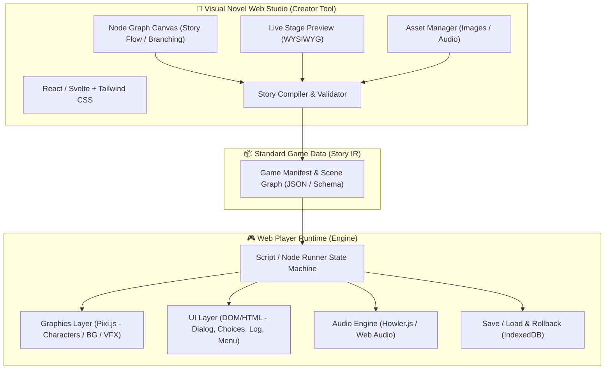
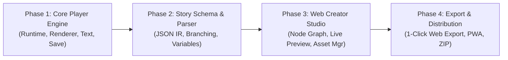

# 🎭 Web Visual Novel Engine & Creator System Architecture

เอกสารวิเคราะห์และวางแผนสถาปัตยกรรมระบบเครื่องมือสร้าง Visual Novel บนเว็บ พร้อม Runtime Engine สำหรับผู้เล่นเล่นผ่าน Browser ได้ทันที

---

## 1. การวิเคราะห์ GitHub Repositories ชั้นนำ

จากการสำรวจ Open-source Visual Novel Engine ที่ทำงานบน Web พบ 4 สถาปัตยกรรมหลักที่น่าสนใจและสามารถนำข้อดีมาสังเคราะห์เข้าด้วยกัน:

| Repository / Engine | Tech Stack | จุดเด่น (Strengths) | ข้อจำกัด (Weaknesses) | ความเหมาะสมกับโปรเจกต์ |
| :--- | :--- | :--- | :--- | :--- |
| **[OpenWebGAL / WebGAL](https://github.com/OpenWebGAL/WebGAL)** | TypeScript, PixiJS, React, FluentUI | • ประสิทธิภาพ Render สูงด้วย PixiJS (WebGL)<br>• รองรับ Live2D, Shaders, Weather effects<br>• มีโปรแกรม Editor (WebGAL Terre) | • ตัว Editor (Terre) ทำเป็น Electron desktop ไม่ได้เปิดใช้ผ่านเบราว์เซอร์ 100%<br>• Core มีความซับซ้อนสูง | ⭐⭐⭐⭐ (แนะนำดึง Render Pattern & Script Syntax มาใช้) |
| **[Monogatari](https://github.com/Monogatari/Monogatari)** | TypeScript, Web Components, CSS3 | • เบามาก (Zero Canvas overhead)<br>• Responsive สเกลสวยบนมือถือและจอคอม<br>• ระบบ Rollback / Save State ใน LocalStorage แข็งแกร่ง | • ไม่มี GUI Visual Graph Editor ในตัว (เน้นเขียนโค้ด JS/Script)<br>• กราฟิก/เอฟเฟกต์ซับซ้อนจำกัดอยู่แค่ CSS animations | ⭐⭐⭐⭐ (แนะนำดึงสถาปัตยกรรม Action System & Rollback มาใช้) |
| **[Narrat Engine](https://github.com/liana-p/narrat-engine)** | TypeScript, Vue, Pinia | • ระบบ State management สะอาดมาก<br>• มี Quest, Inventory, Skill check ในตัว<br>• สคริปต์สไตล์ Ren'Py ที่อ่านง่าย | • Layout หน้าตาเน้นไปทาง RPG / Disco Elysium มากกว่า Classic VN | ⭐⭐⭐ (เหมาะสำหรับศึกษา Game State & Variable System) |
| **[NarrativeNode](https://github.com/LSXPrime/NovelNode) / [tuesday-js](https://github.com/Kirilllive/tuesday-js)** | React, React Flow, Zustand / Vanilla JS | • มี Node Graph ให้ลากต่อเส้นเนื้อเรื่อง (Branching Story) เห็นภาพรวมง่าย<br>• ทำงานบน Web Browser ได้ 100% | • tuesday-js UI ค่อนข้างล้าสมัย<br>• NarrativeNode มีแค่ฝั่งวางพล็อต ไม่มี Player Engine เต็มรูปแบบ | ⭐⭐⭐⭐ (แนะนำดึง Node Editor UI Pattern มาใช้ทำ Creator Studio) |
| **[renpy/renpyweb](https://github.com/renpy/renpyweb)** | C, Python, Emscripten, WebAssembly | • Export เกม Ren'Py เดิมให้เล่นบน Web ได้<br>• ใช้ Engine มาตรฐานอุตสาหกรรม | • **ปัจจุบัน Repo ถูก Archived (Read-only)**<br>• Bundle Wasm ใหญ่มาก (15-30MB+ ก่อนโหลด asset)<br>• โหลดช้า กินแรมสูง ไม่ใช่ Web-Native<br>• ไม่ใช่เครื่องมือสำหรับสร้างบนเว็บ | ⭐⭐ (มีประโยชน์เฉพาะศึกษา Syntax และอาจทำ Importer ในอนาคต) |

---

## 2. การสังเคราะห์และสถาปัตยกรรมเป้าหมาย (Target Architecture)

เพื่อตอบโจทย์ **"สร้างเกมได้บนเว็บ + ผู้เล่นเปิดเล่นบน Browser ได้ลื่นไหล"** สถาปัตยกรรมที่ดีที่สุดคือระบบ **Decoupled Architecture** แบ่งเป็น 2 ส่วนหลัก:



---

## 3. รายละเอียดส่วนประกอบระบบ (System Components)

### 3.1 Data Format: Story Intermediate Representation (IR)
สร้าง Schema ข้อมูลมาตรฐาน (JSON) ที่แปลงมาจาก Node Graph และใช้เป็นตัวขับเคลื่อนเกม:

```typescript
export interface GameProject {
  meta: {
    title: string;
    author: string;
    version: string;
    resolution: { width: number; height: number }; // เช่น 1920x1080
  };
  characters: Record<string, CharacterDef>;
  variables: Record<string, any>;
  scenes: Record<string, SceneNode>;
  startSceneId: string;
}

export interface CharacterDef {
  id: string;
  name: string;
  color: string;
  sprites: Record<string, string>; // emotion -> assetUrl ("happy": "/assets/alice_happy.png")
}

export interface DialogueStep {
  type: "dialogue" | "choice" | "scene_change" | "play_audio" | "set_variable" | "condition";
  speaker?: string; // character id
  text?: string;
  background?: string;
  characters?: Array<{ id: string; sprite: string; position: "left" | "center" | "right" | { x: number; y: number } }>;
  audio?: { bgm?: string; voice?: string; sfx?: string };
  choices?: Array<{ label: string; targetSceneId: string; condition?: string }>;
  next?: string;
}
```

### 3.2 Web Player Runtime (ฝั่งผู้เล่น)
* **Hybrid Renderer**:
  * **PixiJS (WebGL Canvas)**: เรนเดอร์ Background, Character Sprites (Crossfade, Zoom, Shake), Particle VFX และ Shader transitions ได้ลื่น 60 FPS บนมือถือและคอมพิวเตอร์
  * **HTML/DOM Layer**: ข้อความ Text box, Typewriter effect, ปุ่มเลือก Choice, History Log, หน้า Settings เพื่อความคมชัด 100% ทุกขนาดหน้าจอและรองรับ Accessibility / Screen Reader
* **History & Rollback**:
  * เก็บ History Stack แบบ State Snapshot ย้อนกลับไปดูบทสนทนาเก่าและย้อน State ตัวแปรได้ตลอดเวลา
* **Storage Engine**:
  * ใช้ `IndexedDB` (ผ่าน `idb-keyval`) เพื่อให้เซฟเกมได้หลาย Slot พร้อมบันทึกภาพ Thumbnail หน้าจอตอนเซฟ

### 3.3 Web Creator Studio (ฝั่งผู้สร้าง)
* **Visual Node Canvas**: ใช้ **React Flow** หรือ **Svelte Flow** ให้ผู้สร้างลากต่อกล่องข้อความ, ทางแยกตัวเลือก (Choices), จุดเปลี่ยนฉาก (Branching/Merge)
* **Live Stage Inspector**: จำลองหน้าจอเกมแบบ Real-time ขยับจัดวางตำแหน่งตัวละครแบบ Drag & Drop
* **Asset Manager**: อัปโหลดรูป Background, Sprite ตัวละครหลายอารมณ์, เพลง BGM และเสียงพากย์
* **Export Engine**:
  * **Standalone Web Export**: รวมไฟล์โปรเจกต์เป็น Zip ที่มี `index.html` + asset นำไปอัปโหลดขึ้น Itch.io, Vercel, Netlify หรือ GitHub Pages เล่นได้ทันที
  * **Shareable Web Link**: แชร์ Link URL ให้คนอื่นเข้ามาเล่นผ่าน Web Player ได้ทันที

---

## 4. แผนงานการพัฒนา (Roadmap)



1. **Phase 1: Minimal Web Player (สัปดาห์ที่ 1)**
   - สร้าง Runtime ด้วย Pixi.js + HTML overlay
   - ทำระบบ Typewriter text, Character display, BGM/SFX, Dialog choices
   - ระบบ Save/Load Slot ด้วย IndexedDB

2. **Phase 2: Scripting & State Management (สัปดาห์ที่ 2)**
   - ตัวแปรเกม (Flags, Affection points, Inventory)
   - เงื่อนไขบทสนทนา (Conditions: `if score >= 10 then ...`)
   - ระบบ History Rollback

3. **Phase 3: Visual Novel Creator Studio (สัปดาห์ที่ 3)**
   - Node-based Story Canvas (React Flow / Svelte Flow)
   - หน้าจัดการตัวละคร (Character & Expressions Manager)
   - Live Preview Window (เล่นทดสอบได้ทันทีในตัว Editor)

4. **Phase 4: Packaging & Polish (สัปดาห์ที่ 4)**
   - 1-Click Export เป็น Static Web Package (ZIP Bundle พร้อมเล่น)
   - Responsive Touch Controls สำหรับสมาร์ตโฟนและแท็บเล็ต
   - ตัวแปลง/นำเข้าสคริปต์สไตล์ Ren'Py (`.rpy` Importer เบื้องต้น)

---

## 5. แผนการสร้างเชิงเทคนิค (Technical Implementation Blueprint)

### 5.1 Tech Stack ที่คัดเลือก (Optimal Web-Native Stack)

| Layer | Technology | เหตุผลในการเลือก (Rationale) |
| :--- | :--- | :--- |
| **Monorepo / Build** | **pnpm workspaces + Vite + TypeScript** | Build เร็วระดับมิลลิวินาที แยก Package ระหว่าง `schema`, `engine`, `studio` ได้ชัดเจน |
| **Player Graphics** | **Pixi.js (v8) / HTML5 Canvas** | เรนเดอร์ฉากหลัง ตัวละคร Crossfade และ Camera Shake ลื่นไหล 60fps ขนาดไฟล์เล็ก |
| **Player UI Overlay** | **React + Tailwind CSS** | จัดการกล่องข้อความ, ตัวเลือก, History Log, Save Menu คมชัดทุกหน้าจอ (Responsive 100%) |
| **Audio System** | **Howler.js (Web Audio API)** | รองรับ BGM Crossfade, SFX ซ้อนกัน และ Voice Acting บนทุกเบราว์เซอร์รวมถึง iOS Safari |
| **Save & Storage** | **IndexedDB (`idb-keyval`)** | เก็บ Save Slots, Auto-save, Global Persistent Flags และภาพ Screenshot ไม่ติดลิมิต 5MB ของ LocalStorage |
| **Creator Studio UI** | **React + `@xyflow/react` (React Flow) + Zustand** | สร้าง Node-based Story Graph, Undo/Redo State และเชื่อมกับตัว Player Preview ได้ทันทีในหน้าเดียว |
| **Packaging / Export** | **JSZip** | บีบอัดเกมและ Assets ออกมาเป็น `.zip` (Standalone HTML5 Game) บนฝั่ง Client โดยไม่ต้องพึ่ง Backend |

---

### 5.2 โครงสร้าง Deep Modules & Interfaces (Codebase Design)

ออกแบบให้แต่ละโมดูลมี Interface ที่เล็กและชัดเจน (Deep Modules) เพื่อแยกฝั่ง **Editor** ออกจาก **Player Runtime**:

```typescript
// 1. @vn/schema - ศูนย์กลางข้อมูล (Zero Runtime Dependencies)
export interface VNProject {
  id: string;
  meta: { title: string; author: string; resolution: [number, number] };
  assets: {
    backgrounds: Record<string, string>;
    characters: Record<string, { name: string; color: string; sprites: Record<string, string> }>;
    audio: Record<string, string>;
  };
  variables: Record<string, number | string | boolean>;
  startNodeId: string;
  nodes: Record<string, VNNode>;
}

export type VNNode =
  | { id: string; type: "dialogue"; speakerId?: string; expression?: string; text: string; bgId?: string; bgmId?: string; nextId?: string }
  | { id: string; type: "choice"; prompt?: string; options: Array<{ label: string; condition?: string; setVar?: Record<string, any>; targetId: string }> }
  | { id: string; type: "branch"; condition: string; trueId: string; falseId: string };

// 2. @vn/engine - ตัวรันเกม (ใช้ได้ทั้งในหน้าเว็บผู้เล่น และฝังเป็น Live Preview ใน Studio)
export interface VNEngineController {
  loadProject(project: VNProject): Promise<void>;
  step(): void;                        // ไปยังบทสนทนาถัดไป
  choose(optionIndex: number): void;   // เลือกตัวเลือก
  rollback(): boolean;                 // ย้อนกลับ 1 ก้าว (State Snapshot)
  saveSlot(slotId: string): Promise<SaveMetadata>;
  loadSlot(slotId: string): Promise<void>;
  getState(): Readonly<VNRuntimeState>;
}
```

---

### 5.3 ลำดับขั้นการลงมือสร้างจริง (Step-by-Step Execution Plan)

1. **Step 1: Project Scaffolding & `@vn/schema`**
   - ตั้งค่า Workspace ใน `/Users/macminim4pro/FrostNova/FrostNovaWorkspace/projects/Visual Novel`
   - สร้าง TypeScript Schema, ตัว Validate โปรเจกต์ และเกมตัวอย่าง (`demo-project.json`)
2. **Step 2: `@vn/engine` (Web Player Runtime)**
   - สร้าง State Machine สำหรับรัน Node (`dialogue`, `choice`, `branch`), ระบบตัวแปร และ History Rollback Stack
   - สร้าง Stage Renderer (แสดงฉากหลัง, ตัวละคร, กล่องข้อความ Typewriter, ปุ่มทางเลือก, BGM/SFX)
   - สร้างระบบ Save / Load ผ่าน IndexedDB
3. **Step 3: `@vn/studio` (Visual Creator Tool)**
   - สร้างหน้าต่าง Node Graph Editor ด้วย React Flow ให้ลากเชื่อมบทสนทนาและทางแยกได้
   - สร้างหน้าต่าง Inspector แก้ไขคำพูด ตัวละคร ฉากหลัง และตัวแปร
   - ฝัง `@vn/engine` เป็นหน้าต่าง **Live Playtest Preview** ข้างๆ Node Editor (แก้ปุ๊บ ทดสอบเล่นได้ทันที)
4. **Step 4: Web Export & Standalone Player**
   - ทำปุ่ม **Export Game (.json / .html)** เพื่อให้ผู้สร้างนำไปเผยแพร่บนเว็บไซต์ให้นักเล่นเกมเข้ามาเล่นได้ทันที
