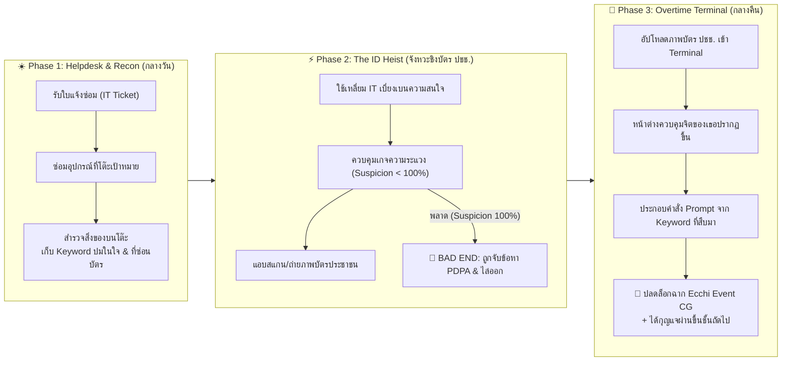

# 🌙 Overtime Secrets (แฟ้มลับกะดึก) — Master Game Design & Build Plan

> **Genre:** Ecchi Psychological Visual Novel / Office Infiltration / Romance  
> **Rating:** R-15 (Sensual Ecchi & Fan Service — No Explicit Pornography)  
> **Platform:** FrostNova Web Visual Novel Engine & Studio (100% Web-Native React + TypeScript + Vite)  
> **Protagonist:** **อาร์ม (Arm)** — พนักงาน IT Support ระดับปฏิบัติการ  
> **Final Boss / Main Heroine:** **คุณหนู เร-อา (Rhea)** — ลูกสาวประธานบริษัท ลุค Cool Beauty ว่าที่ CEO คนต่อไป  

---

## 1. แก่นเรื่องและจุดขายหลัก (Core Concept & Hook)

**"อาร์ม"** ช่าง IT Support ต็อกต๋อยประจำตึกสำนักงานใหญ่ ที่ทุกคนในออฟฟิศมองข้ามและคอยเรียกใช้งานจิปาถะ (ซ่อมปริ้นเตอร์ ดึงกระดาษติด เสียบสายแลน) ต้องอยู่ทำงานล่วงเวลา (Overtime) ในห้องเซิร์ฟเวอร์ชั้นใต้ดินตามลำพัง

ในคืนที่บริษัทกำลังอัปเกรดระบบสู่ยุค AI อาร์มบังเอิญค้นพบ **Terminal ลับของ AI Agent ปริศนา (โค้ดเนม: DAEMON)** ที่สามารถแทรกแซงความทรงจำ ความรู้สึก และความปรารถนาเบื้องลึกของใครก็ได้ในตึกนี้... 

### กฎเหล็กเพียงข้อเดียวของระบบ (The Core Rule):
> **"หน้าต่าง Terminal ของเป้าหมายจะปรากฏขึ้น ก็ต่อเมื่อผู้ใช้อัปโหลด 'ภาพถ่ายบัตรประชาชนตัวจริง' ของเป้าหมายเข้าสู่ระบบเท่านั้น"**

หากอาร์มใจร้อน แอบค้นของหรือถ่ายบัตรประชาชนอย่างไม่ระมัดระวังจนถูกจับได้ เขาจะถูกแจ้งข้อหา **"ละเมิดข้อมูลส่วนบุคคล (PDPA)"** ถูกไล่ออกและส่งดำเนินคดีทันที (**GAME OVER**)

### ทิศทางงานภาพและการกำกับเรื่อง (Visual Novel Style Manhwa):
- เล่าเรื่องในสไตล์ **Visual Novel ผสมผสาน Manhwa เกาหลี** (Office Suspense & Romance Webtoon)
- **ปลดล็อกข้อจำกัด POV (ไม่บังคับว่าต้องไม่เห็นหน้านายอาร์ม):** สามารถแสดงตัวละครนายอาร์ม (Arm) บนหน้าจอได้อย่างอิสระ มี Visual Identity ที่ชัดเจน (ช่าง IT หนุ่มหล่อผมดำเซอร์ เสื้อโปโลกรมท่า สายคล้องบัตรฟ้า) เพื่อถ่ายทอดการสบตา ปฏิกิริยาอารมณ์ และเคมีระหว่างอาร์มกับสาวๆ ในรูปแบบมันฮวา

---

## 2. ลูปการเล่น 3 ช่วงเวลาในแต่ละด่าน (The 3-Phase Gameplay Loop)

---

## 3. โครงสร้าง 5 ด่านสู่ยอดตึก (5-Stage Tower Progression)

ผู้เล่นต้องสะสม **Security Clearance Keys** และความช่วยเหลือจากสาวๆ แต่ละชั้น เพื่อทะลวงระบบรักษาความปลอดภัยขึ้นไปยังชั้น 20 เพนท์เฮาส์ของคุณหนู เร-อา:

| ด่าน (Stage) | ชั้น / แผนก | เป้าหมาย (Heroine) | คาแรคเตอร์ & ปมในใจ | วิธีได้บัตรประชาชน | รางวัลที่ปลดล็อก (Reward) |
| :---: | :--- | :--- | :--- | :--- | :--- |
| **Stage 1** | ชั้น 2: แผนกการตลาด | **น้องเนย (Noey)** | เด็กฝึกงานสาวขี้อ้อน ซุ่มซ่าม ลึกๆ เครียดกลัวไม่ผ่านโปร | ทำกระเป๋าสตางค์ตกใต้โต๊ะทำงานตอนเรียกอาร์มมาดูปลั๊กไฟ | **Level 1 Access** + รหัสล็อกเกอร์ + Event CG ชุดนักศึกษาฝึกงาน |
| **Stage 2** | ชั้น 4: ฝ่ายบุคคล (HR) | **คุณพิมพ์ (Pim)** | ผู้จัดการสาวแว่นเจ้าระเบียบ ดุ เฮี้ยบ แอบแต่งคอสเพลย์ระบายความกดดัน | ลืมสำเนาบัตรไว้ในถาดเครื่องสแกนเนอร์ที่กระดาษติด | **HR Master Keycard** (ขึ้นลิฟต์โซนผู้บริหาร) + แฟ้มประวัติลับ + Event CG ชุดทำงานแนบเนื้อ |
| **Stage 3** | ชั้น 12: ฝ่ายตรวจสอบ (Audit) | **คุณรินดา (Rinda)** | หัวหน้าผู้ตรวจสอบภายใน สาวมั่นลุคเผด็จการ เหนื่อยกับการต้องสมบูรณ์แบบ | ใช้คุณพิมพ์ช่วยโทรดึงความสนใจ แล้วอาร์มแอบซ่อมคอมที่โต๊ะเธอ | **CCTV & Audit Bypass** (สิทธิ์ปิดกล้องวงจรปิดและลบ Log) + Event CG ห้องเซิร์ฟเวอร์ |
| **Stage 4** | ชั้น 19: หน้าห้องผู้บริหาร | **คุณมีนา (Meena)** | เลขาฯ มือขวาของคุณหนูเร-อา สุขุม เฉียบคม เก็บกดจากการเป็นเงาเจ้านาย 24 ชม. | คืนฝนตกหนักไฟสำรองรวน อาร์มขึ้นไปซ่อมระบบหน้าห้องเพนท์เฮาส์ | **Penthouse Passcode** + ความลับวัยเด็กของคุณหนูเร-อา + Event CG ห้องรับรอง VIP |
| **Stage 5 (FINAL)** | ชั้น 20: Penthouse Suite | **คุณหนู เร-อา (Rhea)** | **ลูกสาวประธานบริษัท ลุค Cool Beauty ว่าที่ CEO** เย็นชา ฉลาดเป็นกรด ไม่ไว้ใจใคร | คืนพายุเข้าไฟดับทั้งตึก ใช้สิทธิ์ทั้ง 4 ด่านขึ้นไปเผชิญหน้าสองต่อสองและชิงจังหวะสแกนบัตรจากกระเป๋าคลัตช์ส่วนตัว | **ROOT OVERRIDE** + ฉากจบ True Romance / Puppet Master + Ultimate CEO CG |

---

## 4. ระบบฉากจบ (Multiple Endings)

1. **💖 TRUE ENDING — "System Override: True Heart" (สายชนะใจจริง)**
   - อาร์มใช้ AI Terminal เพื่อช่วยคลายปมในใจและปกป้องคุณหนู เร-อา จากแผนหักหลังของบอร์ดบริหาร ก่อนตัดสินใจลบโปรแกรม AI ทิ้งต่อหน้าเธอ แต่คุณหนู เร-อา กลับเป็นฝ่ายดึงเขาเข้ามาครอบครองด้วยหัวใจของเธอเอง
2. **🔥 SPICY ENDING — "The Shadow CEO" (สายบงการหลังม่าน)**
   - อาร์มเลือกป้อนคำสั่งควบคุมความปรารถนาขั้นสูงสุด กลายเป็นผู้กุมอำนาจเบื้องหลังว่าที่ CEO สาวและสาวๆ ทั้งตึกในทุกคืน Overtime
3. **🚨 BAD ENDINGS (Game Over ตามด่านต่างๆ)**
   - ถูกจับได้ขณะแอบถ่ายบัตรประชาชน (ข้อหาละเมิด PDPA / ไล่ออก / รปภ. ล็อกตัว)
   - ป้อนคำสั่งขัดแย้งกับจิตใต้สำนึกจนเป้าหมายเกิดอาการต่อต้านและแจ้งฝ่ายตรวจสอบ

---

## 5. แผนการสร้างเชิงเทคนิค (Technical Implementation Roadmap)

เราจะพัฒนาต่อยอดบน [`FrostNova Web Visual Novel Engine & Studio`](file:///Users/macminim4pro/FrostNova/FrostNovaWorkspace/projects/Visual%20Novel) ที่มีอยู่แล้ว โดยแบ่งงานเป็น **4 Milestones**:

### Milestone 1: อัปเกรด Core Schema & UI สำหรับระบบ "Overtime Secrets"
- **ไฟล์เป้าหมาย:** [`src/schema/types.ts`](file:///Users/macminim4pro/FrostNova/FrostNovaWorkspace/projects/Visual%20Novel/src/schema/types.ts), [`src/engine/ui/VNPlayer.tsx`](file:///Users/macminim4pro/FrostNova/FrostNovaWorkspace/projects/Visual%20Novel/src/engine/ui/VNPlayer.tsx)
- **สิ่งที่สร้างเพิ่ม:**
  1. **HUD Status Bar:** แสดงค่า `Suspicion %` (ความระแวง), `Security Clearance Level`, และจำนวน `ID Cards Scanned (0/5)`
  2. **AI Terminal Modal / Overlay:** หน้าจอจำลองการอัปโหลดภาพบัตรประชาชน + การเลือกประกอบคำสั่ง Prompt 3 ส่วน (`Target` + `Trigger` + `Override`)
  3. **Dossier & CG Gallery Modal:** หน้าสะสมข้อมูลลับของสาวๆ ทั้ง 5 คน และอัลบั้มภาพ Event CG ที่ปลดล็อกแล้ว

### Milestone 2: สร้างเนื้อเรื่องและสคริปต์ (Scenario & Branching Data)
- **ไฟล์เป้าหมาย:** `src/demo/overtimeSecretsStory.ts`
- **สิ่งที่สร้าง:**
  - เขียนเนื้อเรื่องสมบูรณ์ของ **Stage 1 (น้องเนย)** และ **Stage 2 (คุณพิมพ์ HR)** พร้อมจุดเชื่อมต่อจนถึง **Stage 5 (คุณหนู เร-อา)**
  - ใส่ตัวเลือกสืบค้นโต๊ะทำงาน (Clues), ทางเลือกชิงบัตรประชาชน, จุดพลาดสู่ Bad End (PDPA Game Over), และฉากปลดล็อกหลังรัน Terminal

### Milestone 3: สร้าง Placeholder Art & Pipeline เจนภาพด้วย Local ComfyUI
- **สิ่งที่สร้าง:**
  - สร้าง High-Detail Anime SVG / Illustration Placeholders สำหรับ 5 สาว (น้องเนย, คุณพิมพ์, คุณรินดา, คุณมีนา, คุณหนู เร-อา) และฉากหลัง (ห้อง Server, ออฟฟิศ, ห้อง HR, เพนท์เฮาส์ชั้น 20) เพื่อให้เล่นทดสอบได้ทันที
  - จัดทำไฟล์ **Character Prompt Bible (`CHARACTER_PROMPTS.md`)** สำหรับส่งเข้า Local ComfyUI บน Mac M4 Pro เจนภาพ Sprite หลายอารมณ์ (`normal`, `strict`, `blush`, `flustered`, `seductive`) และภาพ Event CG (R-15 Ecchi)

### Milestone 4: ทดสอบใน Studio & บิลด์ Web Package
- เชื่อมต่อโปรเจกต์เข้ากับตัวสลับเกมใน [`src/App.tsx`](file:///Users/macminim4pro/FrostNova/FrostNovaWorkspace/projects/Visual%20Novel/src/App.tsx)
- ทดสอบ Node Graph ใน [`src/studio/StudioView.tsx`](file:///Users/macminim4pro/FrostNova/FrostNovaWorkspace/projects/Visual%20Novel/src/studio/StudioView.tsx)
- รัน `pnpm build` ตรวจสอบความสมบูรณ์ 100%
