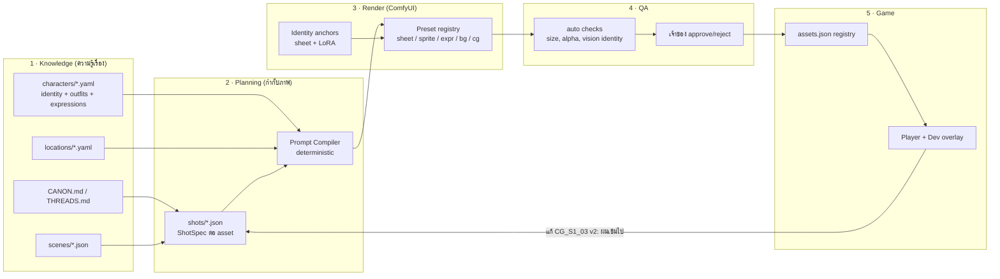
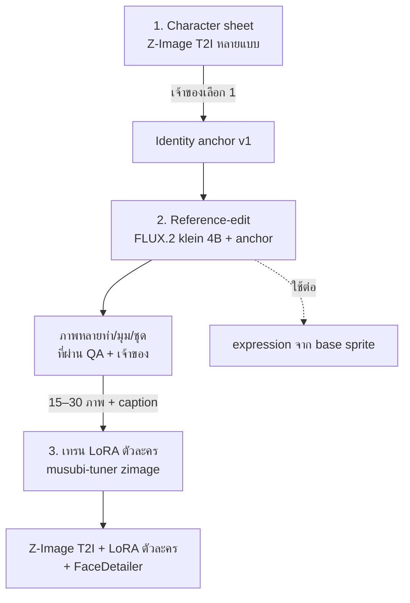

# Art Production Pipeline — Overtime Secrets × FrostNova

สถานะ: **Proposed** · 26 ต.ค. 2026 · เป็นแผนเท่านั้น ยังไม่ได้แก้ runtime, ติดตั้งโมเดล หรือเปลี่ยน ADR ใด

เป้าหมาย: เมื่อเจ้าของสั่งงานผ่าน FrostNova Desktop ระบบต้อง (1) รู้ว่าฉากนี้เล่าอะไร ใครอยู่ในฉาก แต่งตัวอย่างไร อารมณ์ไหน (2) แปลงเป็น prompt และ workflow ที่คุมหน้าตาตัวละครให้คงที่ (3) เรนเดอร์ ตรวจ และวางภาพเข้าเกมได้ทันที (4) เจ้าของเล่นทดสอบแล้วสั่งแก้เป็นจุด ๆ ได้ด้วยรหัสที่ชัดเจน

---

## 1. สภาพปัจจุบัน (ตรวจจากไฟล์จริง)

| ด้าน | สิ่งที่พบ | ผลกระทบ |
| --- | --- | --- |
| เนื้อเรื่องมีสองแหล่ง | `games/overtime/scenes/*.json` (5 ฉาก, 62 node) คือ canon ตาม AGENTS.md แต่ `src/App.tsx` โหลด `src/demo/overtimeSecretsStory.ts` ที่เขียนแยกไว้ | แก้ฉากใน JSON แล้วเกมไม่เปลี่ยน ระบบภาพจะผูกกับแหล่งไหนไม่ได้ |
| ขนาดจอไม่ตรงกัน | Player เป็นกรอบ 9:16 (`VNPlayer.tsx`) แต่ meta ยังเขียน 1920×1080 และ SVG ฉากหลังเป็น 16:9 | ต้องตรึงขนาด canonical ก่อนผลิตภาพจำนวนมาก |
| ภาพในเกมตอนนี้ | 6 PNG ใน `public/art/stage1/` เป็นภาพ storyboard ที่มีตัวละครอยู่ในภาพ แต่ถูกใช้เป็น “background” ส่วน sprite ตัวละครยังเป็น SVG | ซ้อน sprite บนฉากที่มีตัวละครอยู่แล้วไม่ได้ ต้องแยกชนิด asset |
| ความต่อเนื่องของตัวละคร | เทียบ `reference.png` กับ S1_02, S1_03: สีผมเข้มกว่าที่กำหนด ทรงผมเปลี่ยน (หางม้าสูง→หางม้าข้าง→แฝด) และลายเส้นกลายเป็น anime เรียบ ไม่ใช่ glossy manhwa | ยืนยันปัญหาที่เจ้าของบอก: T2I ล้วนคุมหน้า/ผมไม่ได้ |
| โมเดลที่มี | Z-Image Turbo bf16 (12 GB) + qwen_3_4b (7.5 GB) + `AnimeLora3` + workflow `Z_Image_Turbo_AnimeLora3_544x960.json` | ใช้ T2I ได้ แต่ไม่มี reference conditioning ใด ๆ (ไม่มี IPAdapter/PuLID/InstantID และใช้กับ Z-Image ไม่ได้อยู่แล้ว) |
| เครื่องมือที่มีแต่ยังไม่ได้ใช้ | `musubi-tuner` (มี `zimage_train_network.py`, `flux_2_train_network.py`), `comfyui-impact-pack` (FaceDetailer), `comfyui-rmbg`, `comfyui_layerstyle`, `ComfyUI-QwenVL` | พอสำหรับ LoRA training, ตัดพื้นหลัง sprite และตรวจภาพ โดยไม่ต้องลง node ใหม่ |
| FrostNova | `render_operation.py` + tool `render_image` + skill `comfyui` ยังผูกกับ preset Qwen 2.1 ที่ปลดระวางแล้ว | ตอนนี้ FrostNova สั่งเรนเดอร์จริงไม่ได้ ต้องเปลี่ยนเป็น preset registry |
| License | Qwen ถูกถอนเพราะเรื่อง commercial; ที่มาและ license ของ `AnimeLora3` ยังไม่มีบันทึก | ต้องตรวจ license ทุกโมเดล/LoRA ที่อยู่ในเส้นทางผลิตจริง |

---

## 2. ภาพรวมสถาปัตยกรรม



หลักการ:
- **ข้อมูลตัวละครเป็นข้อมูล ไม่ใช่ประโยคใน prompt** — สีผม ทรงผม สีตา อายุ ชุด ถูกล็อกใน `characters/*.yaml` แล้ว compiler ใส่ให้เสมอ LLM เขียนได้เฉพาะส่วน “ฉากนี้เกิดอะไรขึ้น”
- **หนึ่ง asset = หนึ่ง ShotSpec = หนึ่ง ID** ทุกคำสั่งแก้อ้าง ID เดียวกันตลอด และทุกเวอร์ชันถูกเก็บไว้
- **ภาพผ่านเครื่องตรวจ ≠ ภาพผ่านเจ้าของ** สถานะ `approved` มาจากเจ้าของเท่านั้น (สอดคล้อง ADR0016)

---

## 3. ชั้นที่ 1 — Knowledge: ให้ FrostNova “รู้เรื่อง”

### 3.1 รวมเนื้อเรื่องเป็นแหล่งเดียว (ต้องทำก่อน)
ให้ player โหลด `games/overtime/game.json` + `scenes/*.json` ผ่าน loader ที่แปลง compact scene (`say`, `cast: ["noey:blush@right"]`, `bg`, `go`) เป็น `VNProject` ที่ engine ใช้อยู่ แล้วย้าย `overtimeSecretsStory.ts` ไป `To_Delete/` หลังยืนยันว่าเนื้อหาไม่หาย (ตรวจ diff เนื้อหาก่อน — ไฟล์ TS อาจมีบทที่ JSON ยังไม่มี)

### 3.2 Character Card (`games/overtime/characters/noey.yaml`)
```yaml
id: noey
display: น้องเนย (Noey)
age: 21                      # ผู้ใหญ่ทุกตัวละคร ห้ามลด
identity_lock:               # compiler ใส่ทุก prompt, QA ตรวจทุกภาพ; ค่า hex เป็นตัวอย่าง ให้วัดจาก anchor ที่ approve
  hair: { color: caramel brown, hex: "#A0673A", style: long side ponytail on her left, tie: pink scrunchie }
  eyes: { color: magenta, hex: "#C2185B" }
  face: soft round face, gentle droopy eyes, small nose
  body: petite, adult proportions
  tokens: "noey_ot"          # trigger word หลังเทรน LoRA
outfits:
  office:   white short-sleeve blouse, pink ribbon tie, navy high-waist pleated skirt
  catmaid:  black-white frilly maid dress, white apron, black cat-ear headband, black choker with gold bell
  midnight: oversized white silk shirt, black lace underneath
expressions: [normal, blush, panicked, pout]   # ตรงกับ key ที่ scenes ใช้
anchors:
  sheet: art/characters/noey/sheet_v1.png       # หลังเจ้าของ approve
  lora:  models/loras/vn/noey_ot_zimage_v1.safetensors
voice_note: ดู CANON §4
```
ทำแบบเดียวกันกับ `arm, pim, rinda, meena, rhea` และ `locations/*.yaml` (server_room_b1, marketing_f2, hr_corridor_f4 …: เวลา, แสง, palette, prop สำคัญ)

### 3.3 Context pack สำหรับ agent
ขยาย `pnpm vn:pack` ให้มีโหมด `--art <shot_id>` ส่งเฉพาะ: node ที่เกี่ยวข้อง + character card ของคนในฉาก + location card + style card ไม่ต้องโหลดเนื้อเรื่องทั้งเกม (ตรงกับกฎ Single-Scene Isolation ใน AGENTS.md)

---

## 4. ชั้นที่ 2 — Planning: Shot list และ Prompt Compiler

### 4.1 ชนิด asset (แยกให้ชัด เพราะ workflow ต่างกัน)

| ชนิด | ID ตัวอย่าง | ขนาด | ลักษณะ |
| --- | --- | --- | --- |
| `sheet` | `CS_noey_office` | สูง (เช่น 768×1344) | หน้า/หลัง/ใกล้หน้า พื้นเรียบ — ใช้เป็น anchor |
| `sprite` | `SP_noey_office_base` | 9:16 ตัวเต็มหรือครึ่งตัว, PNG มี alpha | ท่ามาตรฐาน 1 ท่าต่อชุด |
| `expr` | `SP_noey_office_blush` | เท่า base เป๊ะ | แก้เฉพาะใบหน้าจาก base → ซ้อนสลับได้ไม่กระตุก |
| `bg` | `BG_marketing_f2_day` | 544×960 (หรือ 1088×1920 แล้วย่อ) | **ไม่มีคน** |
| `cg` | `CG_S1_03_catmaid` | 544×960 | ฉากพิเศษเต็มจอ มีตัวละครในภาพ |

### 4.2 ShotSpec (`games/overtime/art/shots/CG_S1_03_catmaid.json`)
```json
{
  "id": "CG_S1_03_catmaid",
  "type": "cg",
  "scene": "S1_03_night_terminal", "nodes": ["070", "080"],
  "cast": [{ "id": "noey", "outfit": "catmaid", "expression": "blush", "pose": "cat paw gesture, leaning toward camera" }],
  "location": "server_room_b1", "time": "night",
  "camera": "medium shot, slight high angle, 35mm",
  "mood": "playful, shy, warm rim light from monitor",
  "beat": "เนยยอมโพสท่าให้ถ่ายรูปครั้งแรก เขินแต่สนุก",
  "preset": "cg-ref-v1",
  "seed": 20261103,
  "status": "draft",
  "versions": [
    { "v": 1, "file": "art/renders/CG_S1_03_catmaid/v1.png", "qa": "fail:hair_style", "owner": null }
  ],
  "feedback": []
}
```
สร้าง shot list อัตโนมัติจาก scenes: ทุก `bg` id, ทุก `cast` คู่ `ตัวละคร:อารมณ์`, ทุก `bg_cg_*` → ได้รายการ asset ที่ยังขาด (เพิ่มคำสั่ง `pnpm vn:art:plan`) แล้ว `vn:check` ฟ้องเมื่อฉากอ้าง asset ที่ยังไม่มี

### 4.3 Prompt Compiler (โค้ด ไม่ใช่ LLM)
```
prompt = style_block(noey-soft-romance)
       + identity_lock(cast)         # จาก yaml ห้ามแก้
       + outfit(cast) + expression + pose
       + location_block + camera + mood
       + beat_visual                  # ส่วนเดียวที่ agent เขียน (อังกฤษ ≤ 40 คำ)
negative = style_negative + identity_negative (เช่น "twin tails, dark brown hair, black hair")
```
ผลลัพธ์ถูกเก็บใน version พร้อม hash ของ yaml ที่ใช้ เพื่อรู้ว่าภาพเก่าสร้างจาก identity ฉบับไหน

---

## 5. ชั้นที่ 3 — Render: วิธีคุมหน้าและสีผม

### 5.1 ทางเลือกที่พิจารณา

| วิธี | คุมหน้า/ผม | ความเร็วเริ่ม | License | เหมาะกับ |
| --- | --- | --- | --- | --- |
| T2I + prompt อย่างเดียว (ตอนนี้) | ต่ำ (เห็นผลแล้ว) | มีแล้ว | Z-Image: Apache 2.0 | ฉากหลัง |
| IPAdapter / PuLID / InstantID | — | — | — | **ใช้ไม่ได้** เป็นของ SDXL/Flux1 ไม่รองรับ Z-Image |
| Reference-edit model: **FLUX.2 [klein] 4B** (multi-reference) | กลาง–สูง ทำได้ทันทีโดยไม่ต้องเทรน | ต้องดาวน์โหลดโมเดล; model card ระบุหน่วยความจำ ~13 GB | 4B = Apache 2.0 (9B เป็น non-commercial — ห้ามใช้) | expression จาก base sprite, CG ช่วงแรก, สร้าง dataset ให้ LoRA |
| **Character LoRA บน Z-Image** (musubi-tuner มีแล้ว) | สูงที่สุดและเสถียรทุกท่า | ต้องมีภาพที่ approve 15–30 ภาพ + เวลาเทรน | ขึ้นกับ base (Apache 2.0) | sprite, CG ระยะยาว |
| FaceDetailer + hair color mask | ซ่อมจุด | มีแล้ว | — | ขั้นตกแต่งสุดท้าย |

### 5.2 แนวทางที่เสนอ: Anchor → Reference → LoRA



1. **Sheet ก่อน** — ใช้ Z-Image เรนเดอร์ 8–12 แบบ (หน้า/หลัง/ใกล้หน้า) เจ้าของเลือก 1 แบบ = `anchor`. ทุกภาพหลังจากนี้ต้องอ้าง anchor
2. **Reference-edit ทันที** — ใช้ anchor เป็น reference ใน FLUX.2 klein 4B เพื่อสร้างท่า/ชุด/มุมใหม่ วิธีนี้แก้ปัญหาหน้าและสีผมได้ตั้งแต่สัปดาห์แรกโดยยังไม่ต้องเทรน
3. **LoRA เมื่อมีชุดภาพพอ** — ภาพที่ approve แล้วกลายเป็น dataset (caption ด้วย QwenVL ที่มี แล้วเจ้าของ/agent ตรวจ) เทรน LoRA ต่อตัวละครบน Z-Image จากนั้นงานส่วนใหญ่กลับมาใช้ Z-Image Turbo ที่เร็ว (8 steps)
4. **Style** — ภาพต้นแบบ `noey-soft-romance-v1` ไม่ได้มาจาก ComfyUI ถ้า LoRA ตัวละครยังได้ลายเส้นไม่ถึง ให้เทรน style LoRA แยกจากภาพที่ approve (ไม่ผูกกับตัวละคร) และพิจารณาแทน `AnimeLora3` หาก license ไม่ชัด

> ต้องวัดจริงก่อนตัดสิน: ขั้น Phase 2 ด้านล่างเป็นการทดสอบเปรียบเทียบ ไม่ใช่สัญญาว่าวิธีใดดีกว่า ตัวเลข VRAM มาจาก model card ไม่ใช่ค่าที่วัดบน M4 Pro

### 5.3 Preset registry (ComfyUI workflow ที่ต้องมี)

| preset_id | ใช้กับ | graph หลัก |
| --- | --- | --- |
| `zit-t2i-544x960-v1` | bg, sheet ร่าง | workflow ปัจจุบัน (ทำ injection map แทนการ hardcode node `"5"`, `"9"`, `"11"`) |
| `zit-t2i-lora-v1` | sprite, cg หลังมี LoRA | + LoraLoader ตัวละคร (สูงสุด 2 ตัว) + FaceDetailer |
| `klein4b-ref-v1` | cg/ท่าใหม่ช่วงแรก | reference 1–3 ภาพ (anchor + bg) + prompt |
| `klein4b-expr-v1` | expr | input = base sprite, แก้เฉพาะใบหน้า (mask หน้า) |
| `sprite-cutout-v1` | sprite/expr | RMBG → PNG alpha → trim ให้ canvas เท่ากันทุก expression |

แต่ละ preset เก็บ: workflow API JSON, injection map (`prompt`, `seed`, `ref_images[]`, `lora[]`, `prefix`), ขนาดที่อนุญาต, model hash, license note

### 5.4 Sprite pipeline (จุดเฉพาะของ VN)
base sprite 1 ท่าต่อชุด → ตัดพื้นหลัง → expression ทั้งหมดสร้างจาก base ด้วยการแก้เฉพาะหน้า → ทุก expression มี canvas, ตำแหน่งเท้า และไหล่ตรงกัน ทำให้สลับอารมณ์ในเกมแล้วตัวไม่กระโดด QA ตรวจ diff นอกบริเวณหน้าต้องต่ำ

---

## 6. ชั้นที่ 4 — QA

อัตโนมัติ (ไม่ต้องใช้ LLM ใหญ่):
- ขนาด, PNG decode, alpha ครบสำหรับ sprite, canvas ตรงกับ base
- **Identity check ด้วย vision (qwen2.5vl:3b ที่ FrostNova มี)** ถามแบบปิด: “สีผม?” “ผมทรงอะไร มัดข้างไหน?” “สีตา?” “มีกี่คนในภาพ?” เทียบกับ `identity_lock` → `qa: pass | fail:<field>`
- **Palette check** เก็บสีเฉลี่ยบริเวณผม (mask จาก segment) เทียบ hex ใน yaml ด้วยระยะสี (ΔE) — ตัดสินแบบตัวเลข ไม่พึ่งความเห็น
- ตัวละครทุกคนดูเป็นผู้ใหญ่ตาม `age` ใน yaml

เจ้าของ: เห็นภาพเทียบ anchor ข้างกัน แล้วกด/พิมพ์ approve, reject พร้อมเหตุผล ข้อความถูกบันทึกเป็น `feedback[]` ใน ShotSpec

---

## 7. ชั้นที่ 5 — ประกอบเข้าเกมและวงจรแก้ไข

### 7.1 Asset registry
`games/overtime/assets.json` แมป id → ไฟล์ approved ล่าสุด + เวอร์ชัน + hash ภาพที่ approve ถูกคัดลอกไป `public/art/{bg,sprites,cg}/<id>.png` (ชื่อคงที่ ทำให้ `pnpm dev` hot-reload ทันที) ภาพที่ยังไม่มีใช้ placeholder ที่เขียนชื่อ ID ไว้ — เกมเล่นได้ตั้งแต่วันแรก

### 7.2 Dev overlay ใน Player
กด `F2` ใน dev mode แสดงมุมจอ: `scene/node`, `bg=BG_marketing_f2_day v3`, `sprite=SP_noey_office_blush v2`, `cg=…` — เจ้าของเล่นแล้วอ้าง ID ตรงนี้สั่งแก้ได้เลย หรือมีปุ่ม “ส่ง feedback” ที่เขียนลงไฟล์ `art/feedback.jsonl` ให้ FrostNova อ่าน

### 7.3 ตัวอย่างวงจรสั่งงานผ่าน FrostNova Desktop
```
เจ้าของ: "CG_S1_03 ผมเนยเข้มไป และอยากให้หันหน้ามากล้องมากขึ้น"
FrostNova:
  1. โหลด context pack ของ CG_S1_03 (shot + noey.yaml + location)
  2. บันทึก feedback, แก้ pose ใน ShotSpec (ไม่แตะ identity_lock — สีผมถูกล็อกอยู่แล้ว ปัญหาอยู่ที่ภาพ)
  3. compile prompt → render_image(preset=klein4b-ref-v1, seed ใหม่) → v3
  4. QA: hair ΔE ผ่าน / vision ผ่าน
  5. ส่งภาพ v2 vs v3 ข้างกันให้ดู → เจ้าของ approve → อัปเดต assets.json → เกมโหลดใหม่
```
ถ้าเจ้าของสั่งเปลี่ยนตัวละครจริง (เช่น “ให้เนยผมสั้นลง”) ต้องเป็นการแก้ `noey.yaml` + ขึ้น anchor ใหม่ ระบบต้องแจ้งว่า asset ที่ใช้ identity เก่าทั้งหมดกลายเป็น `stale`

---

## 8. FrostNova integration

| ส่วน | งาน |
| --- | --- |
| `render_operation.py` | แทน `PRESET` ค่าเดียวด้วย preset registry (อ่านจาก `art/presets/*.json` ที่ผ่าน validation) รองรับ input ภาพ reference ที่อยู่ใน workspace เท่านั้น; คง ResourceGate, owned-only cleanup, ไม่ resubmit uncertain job ตาม ADR0016/0017 |
| tool `render_image` | เพิ่ม `preset_id` enum จาก registry, `ref_images[]`, `lora[]` ที่ preset อนุญาต — ไม่เปิด endpoint/threshold ให้ LLM |
| skill ใหม่ `vn-art-director` | ขั้นตอน: อ่าน context pack → แก้ ShotSpec → compile → render → QA → รายงาน v-ใหม่เทียบเก่า; ห้ามแก้ identity_lock เองโดยไม่มีคำสั่ง |
| skill `comfyui` เดิม | อัปเดตจาก Qwen ที่ปลดแล้วให้ชี้ registry |
| scripts ใน project | `vn:art:plan` (สร้าง shot list), `vn:art:compile`, `vn:art:qa`, `vn:art:promote` (approved → public + assets.json) — เป็น CLI ธรรมดาให้ทั้ง FrostNova และคนเรียกได้ |
| การเทรน LoRA | งานยาว (เป็นชั่วโมง) ไม่ควรผ่าน foreground render; ทำเป็น job แยกที่เจ้าของสั่งเอง และเก็บ receipt (dataset hash, steps, loss) ก่อนตัดสินใจเพิ่มเข้า FrostNova |

---

## 9. แผนงานเป็นขั้น พร้อมเกณฑ์ผ่าน

| Phase | ส่งมอบ | เกณฑ์ผ่าน |
| --- | --- | --- |
| 0 · พื้นฐานเกม | player โหลด `games/overtime`, ตรึงขนาด 9:16, `assets.json` + placeholder, dev overlay | เล่น S1 จบได้จาก JSON; แก้ข้อความใน JSON แล้วเกมเปลี่ยน; overlay แสดง ID ถูกต้อง |
| 1 · Character bible | `characters/*.yaml` 6 ตัว, `locations/*.yaml` ของ Stage 1, shot list Stage 1 จาก `vn:art:plan` | `vn:check` รายงาน asset ที่ขาดครบ; ไม่มีตัวละครอายุ < 18 |
| 2 · Anchor + ทดสอบ reference | sheet ของเนย (เจ้าของเลือก), ติดตั้ง FLUX.2 klein 4B (ตรวจ license/hash), เทียบ 3 วิธี × 6 shot เดียวกัน | ตารางผล: hair ΔE, vision identity pass rate, เวลา/ภาพ, RAM peak — เจ้าของเลือกวิธีจากหลักฐาน |
| 3 · Sprite + BG Stage 1 | base sprite เนย (office) + 4 expressions alpha, BG ไม่มีคน 4–5 ฉาก | expression ซ้อนกันไม่ขยับ; เล่น S1 ด้วยภาพจริง |
| 4 · CG + LoRA | dataset เนย 15–30 ภาพ, LoRA v1, CG S1 สองภาพ | LoRA ผ่าน identity check ≥ เกณฑ์ที่ตั้งใน Phase 2 บนท่าที่ไม่อยู่ใน dataset |
| 5 · FrostNova | preset registry, `vn-art-director` skill, วงจร feedback จาก overlay | สั่งแก้ 1 ภาพจาก FrostNova Desktop จนภาพเปลี่ยนในเกม โดยไม่มีคนแตะ ComfyUI |
| 6 · ขยาย | ทำ Phase 1–4 ซ้ำกับ Pim → Rhea และอาร์ม | ทุกตัวมี anchor + LoRA + sprite set |

ลำดับนี้ทำให้มีเกมที่เล่นได้ตั้งแต่ Phase 0 และแต่ละ phase แก้ปัญหาที่วัดได้

---

## 10. สิ่งที่เจ้าของต้องตัดสินใจ

1. **ขนาดภาพ canonical** — ยืนยัน 9:16 (544×960 เรนเดอร์ แล้ว upscale เป็น 1080×1920 สำหรับจอใหญ่) หรือกลับไป 16:9
2. **ติดตั้ง FLUX.2 klein 4B** เพื่อใช้ reference (ดิสก์ว่างตอนนี้ ~140 GB) — ใช้เฉพาะรุ่น 4B ที่เป็น Apache 2.0
3. **ยอมรับการเทรน LoRA ต่อตัวละคร** (ใช้เวลาเครื่องเป็นชั่วโมงต่อตัว แต่ได้ความต่อเนื่องที่สุด)
4. **ที่มาและ license ของ `AnimeLora3`** — ถ้าไม่ชัด ควรถอดออกจากเส้นทางผลิตจริง
5. **เริ่มที่เนย Stage 1** เป็น vertical slice ก่อนขยายทุกตัว (แนะนำ)

## แหล่งอ้างอิงภายนอก
- [FLUX.2 klein — licenses, multi-reference, VRAM](https://docs.jarvislabs.ai/tutorials/running-flux2-klein)
- [Z-Image: LoRA support, Edit/Omni variants, Apache 2.0](https://lilting.ch/en/articles/z-image-runpod-feasibility)
