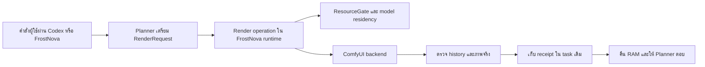

> **Retired 2026-10-26:** Qwen 2.1 weights/profile were removed at the owner’s request. This document is historical; see `art/QWEN21_RETIRED.md`. The reusable render framework remains.

# Framework และ workflow สำหรับ FrostNova สร้างภาพโดยสลับใช้ RAM

สถานะ Proposed วันที่ 26 ตุลาคม 2026 เป็นแผนพัฒนา ไม่มีการแก้ runtime เปลี่ยน Settings unload โมเดล หรือติดตั้งแอปในงานนี้

## ผลลัพธ์สำหรับผู้ใช้

ผู้ใช้สั่งสร้างภาพหนึ่งครั้ง FrostNova เตรียมคำสั่ง พักโมเดลสนทนาเมื่อพร้อมส่งงาน แสดงความคืบหน้าโดยไม่ต้องเรียก LLM ซ้ำ ตรวจภาพจริง คืนหน่วยความจำจากงานเรนเดอร์ แล้วตอบพร้อมภาพและข้อมูลการสร้าง หากผู้ใช้กดหยุด แอปยกเลิกเฉพาะงานนั้นและรายงานผลที่ตรวจได้

รุ่นแรกทำเฉพาะ Qwen Image 2.1 normal T2I, 544×960, batch 1, 25 steps, CFG 1 ไม่รวมวิดีโอ คิวหลายงานตามเวลา หรือระบบทำงานหลังปิดแอป การเปลี่ยนท่าโดยคงสไตล์ด้วย Image Edit เป็นขั้นถัดไป ไม่ถือว่า T2I ใช้ reference conditioning แล้ว

## หลักฐานที่กำหนดรูปแบบ

[รายงานการทดสอบ RAM](../../outputs/2026-10-26-frostnova-qwen21-ram/REPORT.md) ยืนยันว่า ComfyUI สร้างภาพสำเร็จ แต่ FrostNova failed ก่อนรับผลเพราะ `Repeated identical tool batch three times` ตัว runner ถูกหยุด ส่วน ComfyUI ที่แยก process group รันต่อจนจบ

วัดหนึ่งรอบพบ peak footprint ของตัวแอป 0.18 GiB, Ollama 22.45 GiB และ ComfyUI 40.57 GiB พร้อม swap 4.00 ไปสูงสุด 21.25 GiB ตัวเลขแต่ละกลุ่มไม่ใช่ RAM ที่แบ่งขาดจากกัน และ peak อาจเกิดคนละเวลา ผลนี้บอกว่ามีแรงกดดันเมื่อโหลดพร้อมกัน ไม่ได้พิสูจน์ว่าลด swap ได้เท่าไรเมื่อสลับช่วง

Source anchors ใน `~/FrostNova/FrostNovaEngine`:

| ส่วน | พฤติกรรมที่ตรวจแล้ว | นัยต่อแผน |
| --- | --- | --- |
| desktop/runtime/core.py, repeated-action guard | หยุด tool batch ซ้ำครั้งที่สาม | ให้ runtime รอผลเองภายในคำสั่งเดียว |
| desktop/runtime/managed_terminal.py | process ของ terminal อยู่ได้เพียง agent run | ไม่ใช้ terminal เป็นเจ้าของ render server |
| desktop/runtime/model_broker.py, ResourceGate | กันการทำงานหนักพร้อมกัน แต่ไม่ unload weights | ขยาย owner เดิมให้จัด residency |
| desktop/runtime/model_roles.py | warm-up แบบ keep_alive 30m | ต้องพัก warm-up ระหว่าง render |
| desktop/runtime/embeddings.py | เรียก API โดยไม่ผ่าน gate เดียวกัน | ต้องย้าย admission มาอยู่ owner เดียวกัน |
| desktop/runtime/service_health.py, stop | หยุด process ที่ฟังพอร์ตด้วย | ต้องมี owned-only cleanup สำหรับงานอัตโนมัติ |
| docs/decisions/0010-local-model-roles.md | warm-up ไม่ unload โมเดลอื่น | ต้องบันทึกข้อยกเว้น render-phase ใน ADR ใหม่ |
| docs/decisions/0012-lean-core-and-runnable-gateway.md | ตัด scheduler และ comfy tools เดิม | เพิ่ม adapter เฉพาะงานที่มีหลักฐานใช้งาน ไม่ฟื้น scheduler |

## แบบที่เลือก

ใช้ Candidate A เป็นฐาน ให้ runtime ในแอปเดิมเป็นผู้ดูแลการทำงานตั้งแต่รับคำสั่งจนคืนผล มี render operation ที่ทำงานตามขั้นตอนตายตัวหนึ่งคำสั่ง ใช้ ResourceGate, Store, transaction ledger และ service supervisor ที่มีอยู่

Candidate B ใช้ connector แยก submit/status/result แต่ยังต้องแก้ host gate เพื่อป้องกัน LLM โหลดกลับเอง จึงเพิ่มเจ้าของ state และขั้นตอนสื่อสารโดยไม่ได้ลดงานที่จำเป็นต่อ RAM safety ของรุ่นแรก รายละเอียดและการตรวจทานอยู่ใน [บันทึกการเลือกแบบ](SYNTHESIS.md)



## Framework แบ่งความรับผิดชอบตามข้อมูลที่ดูแล

| เจ้าของ | หน้าที่ | สิ่งที่ผู้เรียกต้องรู้ |
| --- | --- | --- |
| Planner | แปลคำขอ เลือก preset กำหนด prompt และ seed | ข้อมูลภาพที่ต้องการ |
| Render operation | lifecycle, submission, bounded wait, recovery, output verification | RenderRequest และผล RenderOutcome |
| Model broker และ ResourceGate | การเข้าใช้โมเดลและการสลับ residency | โหมด interactive หรือ render พร้อม owner ของงาน |
| Comfy adapter | graph, capabilities, queue/history, job-specific cancel | backend profile ที่ตรวจแล้ว |
| Store และ evidence เดิม | ข้อมูล job, intent, state transitions และ receipts | task ID กับ operation ID |
| Service supervisor | process/server ที่แอปเริ่มเอง | identity และสิทธิ์ความเป็นเจ้าของที่ตรวจได้ |

แยกโมดูลตามเจ้าของความรู้ ไม่สร้าง load/validate/save wrappers ที่ส่งต่อข้อมูลอย่างเดียว ชื่อไฟล์ด้านล่างเป็นข้อเสนอ ไม่ใช่ source ที่เพิ่มแล้ว

## Interface ที่เสนอ

ผู้ใช้และโมเดลเรียกการทำงานเดียว ไม่สั่ง unload/poll/restore ทีละคำสั่ง:

```python
outcome = render_image(request, cancel=run_cancel, emit=task_events)
```

ข้อมูลที่ต้องมี:

```text
RenderRequest
  preset_id, prompt, seed, output_directory

RenderRecord ที่ runtime สร้าง
  task_id, run_id, operation_id, request_hash, preset_hash
  phase, backend_instance_identity, prompt_id, timestamps, evidence_refs

RenderOutcome
  artifact_result, handoff_result, error, evidence_refs
```

`operation_id` ผูกกับ transaction ที่ runtime จัดให้ ไม่ให้ LLM เปลี่ยนเองเพื่อ retry ข้อมูล model filenames, server address, PID และ unload targets เป็นรายละเอียดของ preset และ host ที่เชื่อถือได้ ไม่เปิดเป็น knobs ใน prompt

ตัวอย่างข้อมูลอยู่ใน [EXAMPLE_REQUEST.json](EXAMPLE_REQUEST.json) เป็นตัวอย่างที่ยังไม่ถูกส่งทำงาน

Tool/catalog integration ต้องเลือกเส้นทาง domain adapter หนึ่งทางและบันทึกข้อยกเว้นที่มีเหตุผลต่อ ADR 0009/0012 ไม่คืนชื่อ comfy_generate แบบเก่า และไม่ให้มีทั้ง generic shell renderer กับ render operation เป็นสองเส้นทางผลิตงาน

## Workflow และการใช้ RAM

```text
PLAN
  -> PREFLIGHT
  -> HANDOFF_TO_RENDER
  -> SUBMIT_ONCE
  -> WAIT_WITHOUT_LLM
  -> VERIFY_OUTPUT
  -> RELEASE_RENDER_MEMORY
  -> RESUME_AGENT
  -> DELIVER
```

| ช่วง | โมเดลที่ควรอยู่ | หลักฐานก่อนขยับต่อ |
| --- | --- | --- |
| PLAN | Agent และโมเดลเสริมเฉพาะที่จำเป็น | prompt และ preset ถูกตรึง |
| PREFLIGHT | ยังไม่โหลด Qwen เพิ่ม | node, weights, output scope, backend identity และ ownership ผ่าน |
| HANDOFF_TO_RENDER | ระบายคำขอ model เดิม แล้วพัก role ของแอปที่อนุญาต | backend ยืนยัน resident state และ RAM admission ผ่าน |
| RENDER | Qwen และ text encoder ตาม graph | Comfy queue/history และ progress จริง |
| VERIFY_OUTPUT | ยังไม่โหลด Agent กลับ | execution_success, decode PNG, 544×960 และ output hash |
| RELEASE_RENDER_MEMORY | คืน allocation ของ Qwen ก่อน | owned server หยุดหรือยืนยัน release ตาม profile |
| RESUME_AGENT | Agent ที่ต้องใช้ตอบเท่านั้น | provider พร้อมและ render lease คืนแล้ว |
| DELIVER | งาน render ไม่ถือ RAM ต่อโดยปริยาย | receipt และภาพปรากฏใน task เดิม |

การ warm vision หรือ embedding แบบเดิมต้องไม่แทรกใน render phase รวมถึง semantic recall, outcome-memory indexing และ startup warm-up ที่เกิดพร้อมกัน Indexing ที่ไม่เร่งด่วนเก็บเป็นงานค้างภายใน task และทำเมื่อกลับ interactive ไม่ต้องเพิ่ม scheduler

UI ยังคงแสดงความคืบหน้าและรับ Stop ได้โดยไม่ต้องมี LLM อยู่ใน RAM ข้อความใหม่ที่ต้องใช้โมเดลรอหลัง render หรือผู้ใช้เลือกหยุดงานก่อน ระบบไม่รับข้อความแล้วทำหาย

## นโยบายคืนและโหลดโมเดลกลับ

1. ถือ render lease จาก ResourceGate เดิมหลัง inference รอบวางแผนจบ ห้าม acquire lock เดิมซ้อนกัน
2. หยุดการรับ model call ใหม่ทุกเส้นทางที่แอปดูแล รอคำขอที่ทำงานอยู่สิ้นสุดหรือยกเลิกตาม scope
3. บันทึก configured roles ที่ resident และสิทธิ์จัดการ ก่อนร้องขอ release
4. ใช้ provider adapter ที่รองรับจริง เช่น Ollama native API พร้อม keep_alive 0 แล้วตรวจ /api/ps อีกครั้ง HTTP 200 อย่างเดียวไม่พอ
5. รอ memory pressure และ available RAM ผ่านเกณฑ์ที่ได้จาก calibration ก่อนส่ง render
6. หลังตรวจภาพ คืน memory ของ render ก่อน จึงเปิด admission ให้ Agent กลับมาตอบ
7. ไม่โหลดทุก enabled role กลับพร้อมกัน เริ่มเฉพาะ Agent และใช้ vision/embedding ตามความต้องการ

การ unload คืนเฉพาะ model residency ไม่เปลี่ยน model selection, context setting หรือประวัติสนทนาที่บันทึกไว้ แต่ KV cache อาจต้องสร้างใหม่และรอบตอบหลัง render อาจช้าจาก cold load ต้องวัดเวลานี้ด้วย ไม่สัญญาว่าได้ RAM คืนโดยไม่มีต้นทุนด้าน latency

[Ollama generate API](https://docs.ollama.com/api/generate) ระบุ keep_alive 0 สำหรับ unload และ [running models API](https://docs.ollama.com/api/ps) ใช้ตรวจ resident state ได้ แต่ provider ในเครื่องที่ใช้โมเดล MLX ต้องทดสอบความเข้ากันจริงก่อนเปิดนโยบายอัตโนมัติ

ชื่อโมเดลใน /api/ps ไม่ยืนยันว่าแอปเป็นผู้ใช้งานรายเดียว หากมีงานของ client อื่นหรือพิสูจน์สิทธิ์จัดการไม่ได้ ให้รายงาน resource contention ไม่ kill process หรือ unload โมเดลของผู้อื่น Gate ใน FrostNova ไม่สามารถห้าม client ภายนอกโหลดโมเดลได้

ไม่ตั้งงบ RAM เป็นค่าตายตัวจากขนาดไฟล์หรือ footprint คนละเวลา รอบแรกของ implementation ต้องวัด sequential residency ก่อนจึงกำหนด admission profile ค่า swap ที่มีอยู่ก่อนรันไม่ใช่เหตุให้รอไม่สิ้นสุด

## Job states และการคืนผล

```text
prepared -> waiting_resources -> releasing_models -> submitting
submitting -> running -> verifying -> releasing_render -> restoring_agent -> succeeded

submitting -> uncertain
running -> cancelling -> cancelled | succeeded | uncertain
any stage -> failed with reason
verified artifact + cleanup problem -> artifact succeeded, handoff unresolved
```

Artifact result และ handoff result ต้องเป็นคนละข้อมูล ภาพที่ตรวจสำเร็จแล้วไม่กลายเป็นภาพล้มเหลวเพียงเพราะโหลด Agent กลับไม่ได้ ให้ UI แสดงภาพพร้อมปัญหาการคืนทรัพยากร และยังไม่เปิด inference ที่อาจชนจนแก้สถานะ resource owner ได้

Success ทางเครื่องไม่ใช่การอนุมัติความสวยหรือความเหมือนต้นแบบของผู้ใช้ Completion criterion ตามระบบเดิมยังต้องรักษา

## เจ้าของ process, Stop และ restart

- Runtime เป็นเจ้าของ operation ส่วน ComfyUI เป็นเจ้าของ sampling ไม่ใช้ detached child ของ managed terminal เป็นเจ้าของบริการ
- Service supervisor ต้องแยก app-owned กับ borrowed backend และตรวจ PID พร้อม process identity ไม่เชื่อเพียงเลขพอร์ตหรือ PID เก่า
- ห้ามเรียก stop เดิมที่ไล่ kill ผู้ฟังพอร์ตใน cleanup อัตโนมัติ ต้องมี owned-only path
- Comfy 0.42 ที่ทดสอบมี job-specific cancel และ targeted interrupt ตรวจ capability ก่อนใช้ และยืนยัน terminal state หลังยกเลิก
- /free เป็น server-global ใช้ได้เฉพาะ instance ที่เป็นของแอป ไม่มีคิวอื่น และ idle แล้ว ห้ามใช้กับ borrowed server โดยอัตโนมัติ
- รุ่นแรกคาดหวังให้เปิดแอปอยู่ระหว่าง render การซ่อนหน้าต่างไม่หยุดงาน แต่ Quit หรือ Stop ต้องเข้าสู่ cancellation และ bounded cleanup
- หากแอป crash อาจมี Comfy ทำต่อได้ จึงเก็บ prompt ID และสถานะ uncertain ให้ startup reconcile ก่อน warm-up ห้ามถือว่า sampler resume หรือ render ต่อหลังปิดแอปเป็นคุณสมบัติที่รับรอง
- ถ้าไม่ยืนยันว่า Qwen คืน memory แล้ว ห้าม restore Agent อย่างมืดบอด ให้คง resource-contention status พร้อมคำสั่งหยุดที่ทำได้โดยไม่ใช้ LLM

## ป้องกันภาพซ้ำและผลลัพธ์คลุมเครือ

บันทึก intent, request hash และ caller prompt UUID ก่อน POST /prompt ใช้ operation เดิมกับข้อมูลเดิมแล้วคืนสถานะเดิม ข้อมูลเปลี่ยนภายใต้ operation ID เดิมเป็น conflict

Comfy เวอร์ชันที่ตรวจรับ UUID จาก client แต่ enqueue โดยไม่มี durable dedup จึงห้ามส่ง POST ซ้ำอัตโนมัติเมื่อ response หาย ให้ตรวจ queue/history/output ของ prompt เดิมก่อน การใช้ UUID เดิมไม่ใช่หลักประกัน exactly-once

queue/history ของ Comfy เป็นข้อมูลในหน่วยความจำ ถ้า server restart แล้วไม่พบ job ไม่ได้แปลว่าไม่เคยทำ ให้เทียบ backend instance กับ receipt และ output ที่ถูกต้อง หากยังไม่ชัดเจนให้คง uncertain และไม่สร้าง job ใหม่เอง

Store เดิมในแอปเป็นผู้เขียน job state เพียงแห่งเดียว ไฟล์ใน output folder เก็บภาพ graph และ receipt ไม่เป็น task database อีกชุด

## Preset แรกและภาพ reference

Preset ที่เสนอคือ `qwen21-normal-t2i-544x960-v1` ใช้ workflow ที่เรนเดอร์ผ่านแล้วใน [รอบแรก](../../outputs/2026-10-26-qwen21-t2i-544x960-v1/workflow-api.json)

- Qwen 2.1 normal BF16, Qwen3-VL 8B BF16 weights และ Qwen 2.1 VAE
- 544×960, batch 1, 25 steps, CFG 1, Euler, simple
- ไม่ใช้ prompt enhancer, Turbo หรือ LoRA
- style ID `noey-soft-romance-v1` เป็นคำบรรยายสไตล์ใน T2I ไม่ใช่การป้อนภาพ reference
- เก็บเวอร์ชัน Comfy, node requirements, model hashes ที่ตรวจแล้ว และ actual runtime dtypes ใน receipt ไม่สมมติว่า dtype ทุกส่วนเท่าชนิดไฟล์
- ตัว core ที่พิสูจน์ได้เป็น ComfyUI 0.42.0 ใน scratch ไม่ใช่บริการหลัก 0.33.0 พอร์ต 8188 ต้องมีแผนย้าย service profile ไปชุดที่รองรับหลังทดสอบ LTX เดิม โดยรักษา local changes ไม่ pull ทับ

## ขอบเขตไฟล์ที่เสนอให้พัฒนา

| ส่วน | การเปลี่ยนที่จำเป็น |
| --- | --- |
| render_operation.py ใหม่ | การทำงานหนึ่งภาพ, wait, reconciliation, verification |
| model_broker.py | ResourceGate เจ้าของ render lease และ admission |
| model_roles.py | provider release/observe/restore ที่มีสิทธิ์ชัดเจน |
| core.py และ tools.py | ต่อ adapter กับ transaction เดิมและ progress events |
| embeddings.py, vision call sites, warm-up | ให้ model admission ผ่าน owner เดียวกัน |
| store.py | durable render record ใน task/transaction เดิม |
| service_health.py | validated Comfy profile และ owned-only lifecycle |
| native UI | แสดง phase, progress, Stop และ output ผ่าน events เดิม |

ไม่สร้าง renderer service ใหม่, generic scheduler, runtime สำเนา, task database อีกชุด หรือโมเดลใหม่ในรุ่นนี้

## แผนพัฒนาและเกณฑ์ผ่าน

| ขั้น | ส่งมอบ | เกณฑ์ผ่าน |
| --- | --- | --- |
| 0. ตรึงหลักฐานและข้อกำหนด | failure fixture, preset, Proposed ADR | รู้เหตุ app failure แยกจาก RAM และมี ownership policy เดียว |
| 1. Adapter และ durable record | fake Comfy server tests | submit ครั้งเดียว, lost response ไม่ส่งซ้ำ, output เสียไม่สำเร็จ |
| 2. Residency handoff | gate และ provider tests | warm-up, inference, vision, embedding โหลดแทรกไม่ได้; external ownership ไม่ถูกแตะ |
| 3. ต่อ runtime และ UI | หนึ่ง render operation พร้อม progress | รอเกินจุด guard เดิมได้ โดยไม่เปลี่ยน repeated-action guard ทั่วไป |
| 4. รันจริงหนึ่งภาพ | FrostNova -> Comfy -> FrostNova receipt | ได้ 544×960, คืน RAM และรับผลใน task เดิม โดยไม่ต้อง Codex cleanup |
| 5. Failure และ restart | Stop/quit/crash/reconcile tests | ไม่ kill งานอื่น ไม่ orphan โดยไร้บันทึก ไม่ replay uncertain job |
| 6. วัดและ release | RAM traces, runtime tests, signed release | ใช้แอปตัวเดิมผ่าน release.sh และรายงานข้อจำกัดตรงผลจริง |

ต้องครอบคลุมกรณี model unload ไม่สำเร็จ, memory ไม่พอ, Comfy node ไม่ครบ, output ผิดขนาด, restore Agent ล้ม, stale completion event และ Comfy หายระหว่างยกเลิก ทดสอบ ownership ด้วย fake server ก่อนงานหนักจริง

การรันหนึ่งรอบยืนยันเส้นทางที่ทดสอบเท่านั้น หากจะอ้างว่าลด RAM หรือเวลาเป็นเปอร์เซ็นต์ ให้เทียบอย่างน้อย 5 รอบต่อแบบ สลับลำดับ ควบคุม cache และ background load แล้วรายงาน median/range พร้อม failures ไม่ยืนยันผลประหยัดจากแบบออกแบบ

## สิ่งที่ต้องบันทึกก่อนเปลี่ยนนโยบายจริง

เสนอ ADR ใหม่ที่ระบุข้อยกเว้น render-phase ต่อ ADR 0010 และ adapter เฉพาะงานต่อ ADR 0009/0012 โดยรักษาแอปตัวเดียวและ policy/evidence เดิม เอกสารนี้ยังไม่เปลี่ยนสถานะ ADR ใด

งานวิเคราะห์และแผนเสร็จในรอบนี้ ส่วน implementation, การทดลอง sequential residency และการ release ยังไม่ได้ทำ
