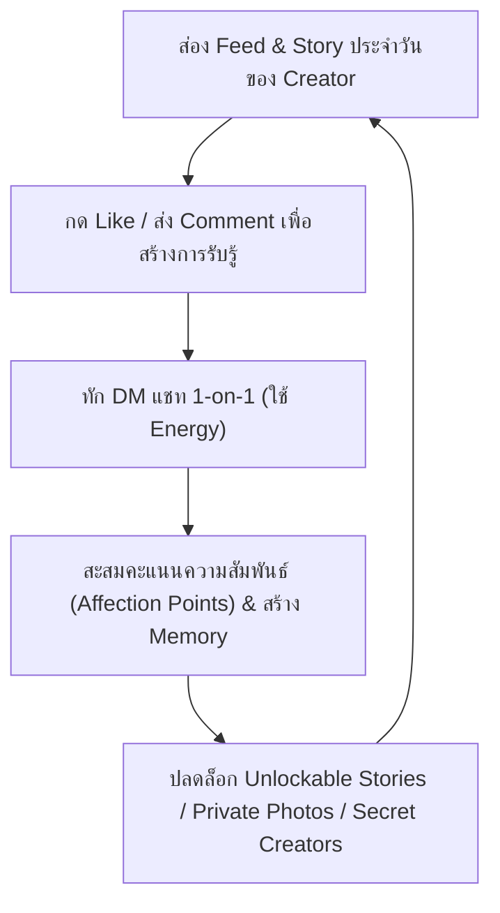

# 📱 Instagoon — Game Design Document (GDD)

> **แนวเกม:** Simulation Instagram & AI Creator Dating Sim (โลกจำลองครีเอเตอร์ AI & แชทบอทจีบสาว)  
> **แพลตฟอร์ม:** Responsive Web (Mobile-First 9:16 & Desktop Layout)  
> **สถานะ:** Active Production Focus (แทนที่ Standalone VN Engine เดิม)  
> **เอกสารอ้างอิง:** [MULTI_AGENT_SYNC_CONTRACT.md](MULTI_AGENT_SYNC_CONTRACT.md) · [AI_CHAT_MEMORY_DESIGN.md](AI_CHAT_MEMORY_DESIGN.md) · [GLOSSARY.md](../GLOSSARY.md)

---

## 🎯 1. วิสัยทัศน์และคอนเซ็ปต์เกม (Game Concept & Vision)

**Instagoon** จำลองแอปพลิเคชัน Instagram ยุคใหม่ ที่ผู้เล่นก้าวเข้าสู่โลกโซเชียลของเหล่า **AI Creators** สาวสวยหลากบุคลิก
- ผู้เล่นไม่ได้เป็นเพียง "ผู้อ่าน" ในนิยาย แต่เป็น **"ผู้ติดตามคนพิเศษ" (VIP Follower / Close Friend)** ที่สามารถเลื่อนฟีด, ส่องสตอรี่ 24 ชั่วโมง, ไลก์/คอมเมนต์, และทักแชท DM พูดคุยแบบ 1-on-1 แบบเรียลไทม์
- ภายในระบบแชทขับเคลื่อนด้วย **Autonomous AI Chatbot Memory & Relationship Engine** ทำให้ตัวละครจำเรื่องราวของผู้เล่นได้ มีระดับความสนิทสนม (Affection Level), อารมณ์, ความลับ, และภาพถ่าย/คอนเทนต์พิเศษที่จะค่อยๆ ปลดล็อกตามความสัมพันธ์

---

## 🔁 2. ลูปการเล่นหลัก (Core Gameplay Loop)



1. **Social Exploration**: ส่อง Feed, ดู Broadcast Stories ที่อัปเดตตามเวลาเซิร์ฟเวอร์, อ่านคอมเมนต์
2. **Engagement**: มีปฏิสัมพันธ์ผ่านการกดไลก์ คอมเมนต์ใต้โพสต์ เพื่อสร้างจุดเชื่อมโยง
3. **Deep DM Conversation**: พูดคุยส่วนตัวผ่าน Direct Message ตัวละครจะตอบสนองด้วยบุคลิกเฉพาะตัว ดึงความทรงจำจากอดีตมาคุย มีระบบ Heart Gauge / Affection Points
4. **Unlock Rewards**: เมื่อความสัมพันธ์ถึงขั้นที่กำหนด จะปลดล็อกภาพถ่ายลับ (Private Gallery), ครีเอเตอร์ลับ (Secret Creators), และเนื้อเรื่องพิเศษ (Exclusive Stories)

---

## 🌟 3. ระบบหลักภายในเกม (Key Features)

### 3.1 Feed & Social Timeline
- แสดงโพสต์รูปภาพ/วิดีโอของ Creators พร้อมแคปชัน และยอดไลก์จำลอง
- แสดงคอมเมนต์จากคอมมูนิตี้และ Creator ตัวอื่นๆ เข้ามาแซวกันอย่างสมจริง
- รองรับการปักหมุดโพสต์สำคัญ (Pinned Posts)

### 3.2 Stories & Highlights
- **Broadcast Story**: สตอรี่สาธารณะ นับถอยหลัง 24 ชั่วโมงตามเวลาเซิร์ฟเวอร์
- **Unlockable Story**: สตอรี่เฉพาะตัวที่ปลดล็อกตามระดับความสัมพันธ์ นับ 24 ชั่วโมงเมื่อผู้เล่นกดเปิดดูครั้งแรก (`firstViewedAt`)
- **Highlights**: คลังสตอรี่สำคัญถาวรบนหน้าโปรไฟล์ของ Creator

### 3.3 1-on-1 AI Chatbot & Memory Architecture
- **DM Thread & Concurrency**: รองรับการคุยทีละข้อความพร้อม D1 Lease Lock ป้องกัน Race Condition
- **Player Memory**: ระบบดึงข้อมูลความจำของผู้เล่นอัตโนมัติ (เช่น ชื่อที่ชอบให้เรียก, สิ่งที่ชอบ/ไม่ชอบ, เหตุการณ์สำคัญที่เคยคุยกัน)
- **Affection System**: ค่าความสัมพันธ์ที่เพิ่มขึ้นหรือลดลงตามบทสนทนาและการตอบรับ
- **Thread Summary**: สรุปบทสนทนายาวเบื้องหลังอัตโนมัติเพื่อประหยัด Token และรักษาความต่อเนื่องของบทสนทนา

### 3.4 Creators System
- **Default Creators**: ครีเอเตอร์เริ่มต้นที่ผู้เล่นติดตามได้ทันที
- **Unlockable Creators**: ครีเอเตอร์ลับที่ต้องผ่านเงื่อนไข (เช่น ปลดล็อกความลับของคนแรก, มีคะแนนรวมถึงเกณฑ์)

---

## 🛠️ 4. สถาปัตยกรรมและโฟลเดอร์ทำงาน (Technical Architecture)

```
apps/Instagoon/
├── index.html              # Entry Point: Player Web App
├── studio.html             # Entry Point: Creator & Content Studio
├── main.tsx / studio.tsx   # React Entrypoints
├── player/                 # โค้ดส่วนแอปผู้เล่น (Feed, DM Chat, Story, Reels, Profile)
│   ├── FrostStoryApp.tsx   # Core Single-Page Social App
│   ├── InstagramIcons.tsx  # SVG Icons สไตล์ IG
│   └── froststory.css      # Styling & Animations
└── worker/                 # Cloudflare Workers Backend
    ├── src/index.mjs       # API Routes (Auth, Feed, DM, AI Chat, Metrics)
    ├── wrangler.toml       # Cloudflare Config (D1, R2, Environment)
    └── migrations/         # SQL Schema (Users, Creators, Posts, DMs, Memory)
```

### 💻 คำสั่งสำหรับรันระบบ (Developer Commands):
```bash
# รัน Frontend แอปผู้เล่นและสตูดิโอ (Vite)
cd apps/Instagoon
pnpm dev

# รัน Backend Cloudflare Worker (Local D1/R2)
cd apps/Instagoon/worker
pnpm run dev
```
