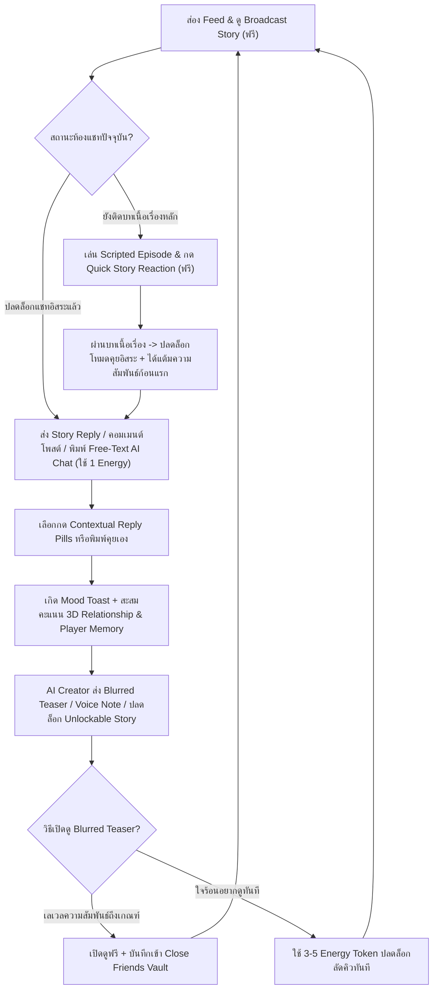

# 📱 Instagoon — Game Design Document (GDD v2.0)

> **แนวเกม:** Social Media Simulation & AI Creator Dating Sim (โลกจำลองโซเชียลมีเดียและแชทบอทจีบไอดอล/ครีเอเตอร์สาว)  
> **แพลตฟอร์ม:** Responsive Web Application (Mobile-First 9:16 Portrait & Desktop Adaptive)  
> **เอกสารที่เกี่ยวข้อง:** [GLOSSARY.md](../GLOSSARY.md) · [MULTI_AGENT_SYNC_CONTRACT.md](MULTI_AGENT_SYNC_CONTRACT.md) · [AI_CHAT_MEMORY_DESIGN.md](AI_CHAT_MEMORY_DESIGN.md) · [ADR 0012](adr/0012-social-dating-loop-blurred-teasers-and-smart-replies.md)

---

## 🎯 1. วิสัยทัศน์และจุดขายหลัก (Game Vision & Unique Selling Points)

**Instagoon** จำลองประสบการณ์การใช้งานแอปพลิเคชัน Instagram ที่ผู้เล่นก้าวเข้าสู่โลกโซเชียลของเหล่า **AI Creator** สาวสวยหลากคาแรคเตอร์ที่มีชีวิตจิตใจ ตารางเวลาชีวิต (`Character Bible`) และสังคมของตัวเอง (`World Canon`)

### จุดเด่นที่เหนือกว่าคู่แข่งในตลาด
1. **Social-to-DM Living Bridge:** ไม่ใช่แค่ห้องแชทลอยๆ แต่การไปกดไลก์ คอมเมนต์ใต้โพสต์ หรือกด **`Story Reply`** จากหน้าสตอรี่ 24 ชั่วโมง จะส่งผลและเชื่อมเข้าสู่บทสนทนาใน **`DM Thread`** ทันทีเหมือนจีบกันบน IG จริง
2. **Zero-Friction Mobile Flirting:** มีระบบ **`Contextual Reply Pills`** (ชิปคำตอบแนะนำ 3 สไตล์ตามบริบท) ช่วยให้ผู้เล่นมือถือกดโต้ตอบได้ลื่นไหลด้วยมือเดียว หรือเลือกพิมพ์เองได้อย่างอิสระ
3. **Blurred Teaser & Close Friends Vault:** ระบบส่งภาพลับติดเบลอ (**`Blurred Teaser`**) ในจังหวะเข้าด้ายเข้าเข็ม พร้อมแท็บสะสม **`Close Friends Vault`** บนหน้าโปรไฟล์ที่กระตุ้นให้ผู้เล่นอยากปลดล็อกความลับของสาวๆ ให้ครบ 100%
4. **Rich Media Immersion:** ผสานภาพนิ่ง 544×960 คุณภาพสูง เข้ากับ **`Living Portrait`** (ภาพเคลื่อนไหวลูป 3–5 วินาทีในสตอรี่/โปรไฟล์) และ **`Voice Note`** (แผ่นเสียงพูดอ้อนในจังหวะสำคัญ)

---

## 🔁 2. ลูปการเล่นหลัก (Core Gameplay Loop)



---

## 🌟 3. ระบบหลักภายในเกม (Core Systems & Mechanics)

### 3.1 หน้าโปรไฟล์ AI Creator 3 แท็บ และการค้นหา (Creator Profile & Discovery)
บนหน้าโปรไฟล์ของ **AI Creator** แต่ละคน ถูกออกแบบให้เป็นทั้งหน้าโซเชียลและสมุดสะสมความสำเร็จของผู้เล่น:
- **ส่วนหัวโปรไฟล์ (Profile Header):**
  - รูป Avatar (รองรับวงแหวนแจ้งเตือนเมื่อมีสตอรี่ใหม่)
  - **`Trope Tags`** ป้ายกำกับเสน่ห์และบทบาทชัดเจน (เช่น `#พยาบาลกะดึก`, `#ปากไม่ตรงกับใจ`, `#ขี้อ้อนเฉพาะคนสนิท`)
  - คำคมประจำตัว (`tagline`) และลิงก์เชื่อมโยงจักรวาลตัวละคร
  - **Relationship Badge (Lv 1–5)** พร้อมกราฟแสดงมิติความสัมพันธ์ 3 แกน (`closeness`, `trust`, `romance`)
- **โครงสร้าง 3 แท็บหลัก:**
  1. **แท็บ Public Feed (ตารางโพสต์สาธารณะ):** แสดงโพสต์รูปภาพ แคปชัน ยอดไลก์ และคอมเมนต์ที่ผู้เล่นและตัวละครอื่นเข้ามาแซวกัน
  2. **แท็บ `Close Friends Vault` 🔒 (คลังความลับคนสนิท):** รวบรวม **`Blurred Teaser`**, รูปรางวัลในแชท, **`Unlockable Story`**, **`Living Portrait`** และ **`Voice Note`** ทั้งหมดของตัวละครนั้น ชิ้นที่ยังไม่ได้ปลดล็อกจะแสดงเป็นภาพเงาเบลอพร้อมคำใบ้เงื่อนไข (เช่น *"ปลดล็อกที่ Lv.3 หรือเมื่อคุยเรื่องความฝันวัยเด็ก"*)
  3. **แท็บ Episodes 📖 (สารบัญเนื้อเรื่อง):** แสดงรายการ **`Scripted Episode`** ทั้งหมดของตัวละคร สถานะตอนที่เล่นผ่านแล้ว และตอนต่อไปที่กำลังจะปลดล็อกเมื่อระดับความสัมพันธ์ถึงเกณฑ์

---

### 3.2 ระบบ Stories & Social-to-DM Bridge
1. **`Broadcast Story` (สตอรี่สาธารณะตามเวลาจริง):**
   - อัปเดตตามตารางเวลาเซิร์ฟเวอร์และหมดอายุใน 24 ชั่วโมงพร้อมกันทุกคน
2. **`Unlockable Story` (สตอรี่เนื้อเรื่องเฉพาะบุคคล):**
   - ปลดล็อกเมื่อคะแนนความสัมพันธ์ถึงเกณฑ์ เริ่มนับเวลา 24 ชั่วโมงเมื่อผู้เล่นกดเปิดดูครั้งแรก (`firstViewedAt`) รองรับสื่อแบบ **`Living Portrait`** (ภาพขยับวนลูป 3–5 วินาที)
3. **การโต้ตอบจากสตอรี่เข้าสู่แชท (`Quick Story Reaction` vs `Story Reply`):**
   - **ช่วงที่ยังเล่น `Scripted Episode` ไม่จบ:** ด้านล่างสตอรี่จะมีปุ่ม **`Quick Story Reaction`** (อิโมจิ 😍 / 🔥 / ❤️) ให้กดส่งได้ฟรีไม่เสีย Energy เพื่อรับเอฟเฟกต์หัวใจและสะสมความประทับใจแรก
   - **เมื่อปลดล็อกโหมดแชทอิสระแล้ว:** เปิดช่องพิมพ์ **`Story Reply`** เต็มรูปแบบ เมื่อกดส่ง (1 Energy) ระบบจะส่งการ์ดอ้างอิงสตอรี่นั้นพร้อมข้อความของผู้เล่นเข้าสู่ **`DM Thread`** และ AI Creator จะโต้ตอบกลับตามรูปและสถานการณ์ในสตอรี่นั้นทันที
4. **Comment-to-DM Memory:**
   - เมื่อผู้เล่นคอมเมนต์ใต้โพสต์ในหน้า Feed ระบบหลังบ้านจะดึงคอมเมนต์ล่าสุดของผู้เล่นเข้าบริบทของห้องแชท ทำให้ AI Creator สามารถทักหรือแซวเรื่องที่ผู้เล่นเพิ่งไปคอมเมนต์ไว้ได้

---

### 3.3 ระบบห้องแชทลูกผสม (Hybrid DM Architecture)
ห้องแชทส่วนตัว (**`DM Thread`**) ผสานจุดเด่นของเกมเนื้อเรื่องและ AI Chatbot เข้าด้วยกัน:

#### ก. โหมดเนื้อเรื่องจัดฉาก (`Scripted Episode`)
- ใช้เล่าเหตุการณ์สำคัญ (First Meet, จุดเปลี่ยนความสัมพันธ์, เดทพิเศษ) ด้วยระบบตัวเลือก (Branching Choices)
- **เล่นฟรีไม่เสีย `Energy Token`** เพื่อให้ผู้เล่นทุกคนได้รู้จักเสน่ห์ของตัวละครและสามารถทำคะแนนไต่ระดับความสัมพันธ์เบื้องต้นได้ (ออกแบบให้เส้นทางที่ดีที่สุดพาผู้เล่นขึ้น Lv.2 ได้ภายใน 1 ตอน ตาม ADR 0008)
- ล็อกรุ่นของบทสนทนาด้วย **`Script Revision`** เพื่อไม่ให้สถานะผู้เล่นพังเมื่อทีมงานอัปเดตบทใหม่

#### ข. โหมดพิมพ์คุยอิสระ (`Free-Text AI Chat`) พร้อมชิปช่วยจีบ (`Contextual Reply Pills`)
- ปลดล็อกเมื่อเล่นจบ `Scripted Episode` บังคับของระดับปัจจุบันแล้ว
- **ชิปคำตอบแนะนำ (`Contextual Reply Pills`):** ทุกครั้งที่ AI Creator ตอบกลับ ระบบจะส่งตัวเลือกข้อความสั้น 3 สไตล์แนบมาด้วยเสมอ (สร้างพร้อมกันใน 1 LLM Call):
  1. 💕 **สายหยอด/โรแมนติก** (เน้นเพิ่ม `romance`)
  2. 😏 **สายกวน/หยอกล้อ** (เน้นเพิ่ม `closeness`)
  3. 💬 **สายใส่ใจ/ชวนคุยเรื่องชีวิตประจำวัน** (เน้นเพิ่ม `trust`)
- ผู้เล่นสามารถกดจิ้มที่ชิปเพื่อส่งข้อความได้ทันทีด้วยมือเดียว หรือจะพิมพ์ข้อความเองตามใจชอบก็ได้

#### ค. ระบบภาพลับติดเบลอ (`Blurred Teaser`) และแผ่นเสียง (`Voice Note`)
- **Dual-Gate `Blurred Teaser`:** เมื่อคุยถูกจังหวะหรือตรงเงื่อนไข Keyword/Semantic ตัวละครจะส่งรูปภาพมาในกรอบเบลอพร้อมแคปชันอ้อน:
  - **ทางเลือกที่ 1 (สายปั้นความสัมพันธ์):** หากระดับความสัมพันธ์ (`Lv`) ของผู้เล่นถึงเกณฑ์ของภาพนั้น สามารถกดเปิดดูภาพชัดได้ **ฟรีทันที**
  - **ทางเลือกที่ 2 (สายลัดคิว):** หากเลเวลยังไม่ถึงแต่ใจร้อนอยากดูเดี๋ยวนี้ สามารถกดใช้ **3–5 `Energy Token`** เพื่อปลดล็อกภาพชัดและเก็บเข้า **`Close Friends Vault`** ได้ทันที
- **Milestone `Voice Note`:** เมื่อจบฉากสำคัญหรือเลื่อนระดับ **`Closeness Tier`** ตัวละครจะส่งข้อความแผ่นเสียงสั้นๆ ให้ผู้เล่นกดฟังเสียงพูดได้ในห้องแชท

---

## ❤️ 4. ระบบความสัมพันธ์ 3 มิติ และความทรงจำ (3D Relationship & Memory Engine)

### 4.1 มิติความสัมพันธ์ 3 แกน (`3D Relationship Dimensions`)
คะแนนความสัมพันธ์ไม่ได้มีแค่หลอดเดียว แต่คำนวณแยกเป็น 3 แกนอิสระ (0–100) บน **`Server-Side NPC Engine`**:
1. **`closeness` (ความสนิทสนม):** เพิ่มจากการคุยเล่น แซว หยอกล้อ และทักทายสม่ำเสมอ
2. **`trust` (ความไว้เนื้อเชื่อใจ):** เพิ่มจากการรับฟังปัญหา จำเรื่องราวส่วนตัวของเธอได้ และไม่ล้ำเส้นเมื่อเธอยังไม่พร้อม
3. **`romance` (ความโรแมนติก):** เพิ่มจากการชม การหยอด และการสร้างบรรยากาศหวานซึ้ง

คะแนนทั้ง 3 แกนจะถูกถ่วงน้ำหนักตามนิสัยของตัวละครแต่ละคนเพื่อคำนวณเป็น **ระดับความสัมพันธ์รวม (Lv 1–5)** และแบ่งน้ำเสียงการพูดออกเป็น 3 **`Closeness Tier`**:
- **Tier 1 (`Stranger / Polite` — Lv.1):** สุภาพ รักษาระยะห่าง มีฟอร์ม
- **Tier 2 (`Casual / Flirty` — Lv.2–3):** สนิทสนม แซวเล่น กล้าส่งรูปชีวิตประจำวันและบ่นเรื่องงานให้ฟัง
- **Tier 3 (`Intimate / Deep` — Lv.4–5):** เปิดใจ เล่าปมความลับ แสดงความหึงหวงและอ้อนเต็มที่

### 4.2 การแสดงผลอารมณ์ในแชท (`Mood Toast`) vs กราฟโปรไฟล์
- **ในห้องแชท (`DM Thread`):** จะ**ไม่แสดงตัวเลขดิบ** (เช่น `+2 Closeness`) เพื่อไม่ให้เสียบรรยากาศการคุยกับคนจริง แต่จะแสดงเป็น **`Mood Toast`** ลอยขึ้นมาอย่างนุ่มนวล เช่น *"เนยแอบยิ้มกับข้อความของคุณ 💕"* หรือ *"มิลินรู้สึกไว้ใจคุณมากขึ้น ✨"*
- **ในหน้าโปรไฟล์:** ผู้เล่นสามารถเปิดดูกราฟเรดาร์ทั้ง 3 แกนและเงื่อนไขการขึ้นเลเวลถัดไปได้อย่างละเอียด

### 4.3 ระบบความจำและโต้ตอบสมบทบาท (`Player Memory` & `In-Character Retaliation`)
- **`Player Memory` (`player.*`):** AI จดจำข้อเท็จจริงเกี่ยวกับผู้เล่น (ชื่อเล่น, ของที่ชอบ, สัญญาที่เคยให้ไว้) แยกตามแต่ละ `DM Thread`
- **`Thread Summary`:** สรุปประวัติการคุยระยะยาวอัตโนมัติทุกๆ 20 ข้อความเพื่อประหยัด Token และทำให้ตัวละครจำเรื่องเก่าได้แม่นยำ
- **`In-Character Retaliation`:** หากผู้เล่นพิมพ์กวนหรือล้ำเส้น ตัวละครจะดุ งอน หรือตอกกลับตามนิสัยจริง ไม่หลุดพูดภาษาบอทบริการลูกค้า

---

## 💎 5. ระบบเศรษฐกิจและสมดุลพลังงาน (Dual-Loop Economy & Energy Token)

ระบบเศรษฐกิจใช้แนวคิด **Dual Loop** คือเปิดให้เสพเนื้อเรื่องและสำรวจโลกโซเชียลได้ฟรีจนเกิดความผูกพัน แล้วใช้ **`Energy Token`** ในการสนทนาส่วนตัวเชิงลึกและการเปิดภาพลับลัดคิว:

| กิจกรรมของผู้เล่น | ค่าใช้จ่าย (`Energy Token`) | หมายเหตุและเหตุผลเชิงการออกแบบ |
|---|---|---|
| **เลื่อนดู Feed / กด Like โพสต์** | **ฟรี (0 Energy)** | ให้ผู้เล่นเข้าถึงเสน่ห์ตัวละครและบรรยากาศของเกมได้ทุกวัน |
| **ดู `Broadcast Story` & กด `Quick Story Reaction`** | **ฟรี (0 Energy)** | สร้างนิสัยการเข้ามาเช็กสตอรี่สาวๆ ทุกวัน |
| **เล่นเนื้อเรื่องหลัก (`Scripted Episode`)** | **ฟรี (0 Energy)** | ให้ผู้เล่นสายฟรีเล่นเนื้อเรื่องจนตกหลุมรักตัวละครและไต่ถึง Lv.2 ได้ |
| **พิมพ์แชทอิสระ (`Free-Text AI Chat` / กด `Contextual Reply Pills`)** | **1 Energy / ข้อความ** | มีระบบคืนโทเคนอัตโนมัติ (Refund) หาก API ขัดข้องหรือติด Rate Limit |
| **ส่ง `Story Reply` พร้อมข้อความเข้าห้องแชท** | **1 Energy / ครั้ง** | เชื่อมสตอรี่เข้าสู่การคุยส่วนตัวใน DM |
| **เขียนคอมเมนต์ใต้โพสต์ใน Feed** | **1 Energy / ครั้ง** | ได้รับแต้มความสัมพันธ์และตัวละครจำไปพูดถึงใน DM |
| **เปิดดู `Blurred Teaser` เมื่อเลเวลถึงเกณฑ์** | **ฟรี (0 Energy)** | ให้รางวัลผู้เล่นที่ตั้งใจปั้นความสัมพันธ์จนถึงระดับที่กำหนด |
| **ปลดล็อก `Blurred Teaser` แบบลัดคิว (Instant Unlock)** | **3–5 Energy / ภาพ** | ทางด่วนสำหรับผู้เล่นที่อยากเห็นภาพชัดและเก็บเข้า `Close Friends Vault` ทันที |

### โควตารีฟิลรายวันและสมุดบัญชี (`Daily Refill & Token Ledger`)
- **Daily Free Refill:** รีฟิลโทเคนฟรีให้เป็น **10 `Energy Token` ต่อวัน** (เพิ่งพอกับการคุยโต้ตอบ 1 รอบสนทนาจนเจอจังหวะ `Blurred Teaser` พอดี)
- **`Token Ledger`:** ทุกการหักและเพิ่มโทเคน (แยกกระเป๋า `free` และ `purchased` ชัดเจน โดยหัก `free` ก่อนเสมอ) จะถูกบันทึกแบบ Append-Only พร้อมเหตุผลกำกับทุกธุรกรรม

---

## 🛡️ 6. สถาปัตยกรรมระบบและความปลอดภัย (Clean Fullstack & Anti-REA Architecture)

ระบบจัดระเบียบเป็นโครงสร้าง **Clean Fullstack Workspace** พร้อมเกราะป้องกันการแกะโค้ดและขโมยข้อมูล (Anti-REA 5 ชั้น):

```text
projects/Instagoon/
├── client/                     # [Frontend Player SPA] Vite + React 19 + Tailwind CSS
│   ├── player/                 # โมดูลหน้าจอผู้เล่น (Feed, Stories, DM Thread, Close Friends Vault)
│   ├── public/                 # Static headers, legal pages
│   └── vite.config.ts          # Hardened Build (sourcemap: false, chunk hashing, drop console)
│
├── server/                     # [Backend Edge BFF] Cloudflare Worker + D1 SQLite
│   ├── src/
│   │   ├── index.mjs           # API Gateway, Auth, DM Lease Lock, Gemini Orchestrator
│   │   ├── content.mjs         # Air-gapped bundle loader -> D1 idempotent sync
│   │   ├── knowledge.mjs       # Scoped lore & alias matcher
│   │   └── gameplay/           # Pure 3D Relationship & Rule Engine (100% server-side)
│   ├── migrations/             # D1 SQLite Schema Migrations
│   └── tests/                  # Automated Test Suite (Gameplay purity, Episodes, API)
│
├── content/                    # [Git-Driven Content Source of Truth]
│   ├── creators/<id>/          # character.json, visual_bible.json, posts.json, stories.json, episodes.json
│   └── media/                  # 544x960 Pre-rendered Webtoon Assets (avatars, posts, stories, assets)
│
├── packages/contracts/         # [Shared Schemas]
│   └── npc/schema.ts           # NpcSchema v1.0 (Zod validation contract)
│
└── scripts/                    # [Build & Content Verification]
    ├── build-content.mjs       # Validates content & compiles dist/_content bundle
    └── validate-npc-bundle.mjs # Validates incoming NPC ZIP packages
```

### มาตรการความปลอดภัย 5 ชั้น (Anti-REA Defense)
1. **BFF Proxy & Zero Key Leakage:** เบราว์เซอร์ติดต่อผ่าน `/api/*` ของ Cloudflare Worker เท่านั้น ไม่มีการฝัง Gemini API Key หรือชื่อโมเดลไว้ฝั่ง Client
2. **Server-Side Prompt & Rule Vault:** `Character Bible`, กฎการให้คะแนน, ความลับตัวละคร และ Few-Shot Prompts ประมวลผลใน Worker + D1 เท่านั้น ผู้เล่นไม่สามารถเปิด F12 เพื่อดูเงื่อนไขคำตอบได้
3. **Locked Media Gate (`/api/media/:key`):** ไฟล์ใน `/_content/*` ถูกบล็อกการเข้าถึงตรงจากภายนอก (`HTTP 404`) รูปภาพทุกใบต้องผ่านการตรวจสิทธิ์ระดับความสัมพันธ์หรือสถานะการปลดล็อกที่ `/api/media/:key` ก่อนส่งไบต์ภาพ
4. **Zero Source Maps & Obfuscated Chunks:** บังคับปิด Source Maps (`sourcemap: false`), ลบ `console`/`debugger` และเข้ารหัสชื่อไฟล์ JS Chunk ทุกไฟล์ใน Production/Staging
5. **Concurrency Lease & Energy Refund Guard:** ล็อกห้องแชททีละข้อความด้วย `THREAD_LOCK_MS` ป้องกันการยิงสแปมซ้อน และคืน `Energy Token` อัตโนมัติหากโมเดล AI ตอบกลับไม่สำเร็จ
