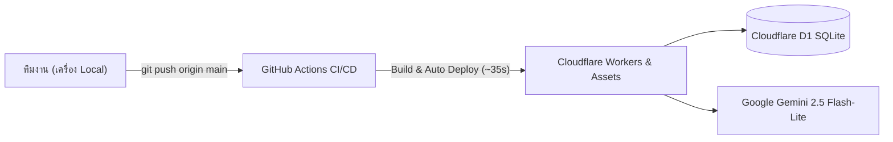

# 📖 คู่มือการติดตั้งและพัฒนาต่อยอด: Instagoon Content Studio

> **สำหรับ:** ทีม Content, นักเขียนบท, และทีมนักพัฒนา (Developers)  
> **โปรเจกต์:** Instagoon (Social Feed + 24h Stories + AI Idol Chatbot)  
> **เวอร์ชัน:** 1.0.0 (Cloudflare Serverless + Gemini 2.5 Flash-Lite Native)

---

## 🌟 1. ภาพรวมระบบ (Architecture Overview)

**Instagoon** เป็นแพลตฟอร์มจำลองโซเชียลมีเดียไอดอลแบบ Interactive มี 2 ส่วนหลัก:
1. **Player Web App (`/`)**: หน้าแอปฝั่งผู้เล่น เลื่อนดูฟีด สตอรี่ และทักแชท DM กับไอดอล (AI Chatbot 100%)
2. **Creator Studio (`/studio`)**: ระบบหลังบ้านสำหรับทีมงาน ใช้เขียนบทฟีด, สตอรี่, ปรับแต่งสมอง AI (Cognitive Engine), กำหนดกฎความสัมพันธ์ 3 มิติ และพรีวิวทดสอบบนจอ iPhone 18 Simulator สดๆ



---

## 🛠️ 2. สิ่งที่ต้องติดตั้งบนเครื่องก่อนเริ่ม (Prerequisites)

1. **Node.js**: เวอร์ชัน 20 หรือ 22 LTS ([ดาวน์โหลดที่นี่](https://nodejs.org/))
2. **pnpm**: ตัวจัดการแพ็กเกจหลักของโปรเจกต์ (หากยังไม่มี ติดตั้งผ่าน Terminal):
   ```bash
   npm install -g pnpm
   ```
3. **Git**: เครื่องมือจัดการเวอร์ชันโค้ด
4. **สิทธิ์เข้าถึง GitHub Repo**: แจ้ง GitHub Username ให้เจ้าของโปรเจกต์เพิ่มสิทธิ์เข้า Repo:
   👉 [github.com/jirapatchumee-netizen/Instagoon](https://github.com/jirapatchumee-netizen/Instagoon)

---

## 🚀 3. ขั้นตอนการติดตั้งครั้งแรก (Initial Setup)

เปิดโปรแกรม **Terminal** (Mac/Linux) หรือ **PowerShell/Git Bash** (Windows) แล้วรันคำสั่งตามลำดับ:

```bash
# 1. Clone โปรเจกต์ลงมาที่เครื่อง
git clone https://github.com/jirapatchumee-netizen/Instagoon.git

# 2. เข้าสู่โฟลเดอร์โปรเจกต์
cd Instagoon

# 3. ติดตั้ง Dependencies ทั้งหมด (ใช้เวลาประมาณ 30-60 วินาที)
pnpm install
```

---

## 💻 4. คำสั่งรันโปรแกรมเพื่อทดสอบบนเครื่อง (Local Development)

### 🌟 4.1 รัน Instagoon Studio & Phone Simulator (งานหลักของทีม Content)
```bash
pnpm --dir apps/Instagoon dev
```
เมื่อรันแล้ว ให้เปิดเบราว์เซอร์ไปที่:
* **Creator Studio:** [http://localhost:5173/studio.html](http://localhost:5173/studio.html)
* **Player App:** [http://localhost:5173/](http://localhost:5173/)

*(สามารถทดสอบแชทกับ AI, ปรับแต่งหน้าตา, ลองคลิกปุ่ม Dev บนเครื่องตัวเองได้แบบ Realtime)*

### 🎮 4.2 รัน Visual Novel Engine หลัก (สำหรับส่วนเกมเนื้อเรื่อง)
```bash
pnpm dev
```
เปิดเบราว์เซอร์ไปที่: [http://localhost:5173](http://localhost:5173)

---

## 📁 5. แผนที่โครงสร้างโค้ด (Where Things Live)

```text
Instagoon/
├── apps/Instagoon/
│   ├── player/                      # หน้าจอฝั่งผู้เล่น (Player App UI)
│   │   ├── FrostStoryApp.tsx        # คอมโพเนนต์หลักฝั่งผู้เล่น + แถบ Dev Drawer
│   │   └── froststory.css           # สไตล์ UI แบบ Instagram
│   ├── worker/                      # Cloudflare Serverless Backend
│   │   ├── src/index.mjs            # API ทั้งหมด, สมอง AI, กฎ 3D, ตรรกะคะแนน
│   │   ├── migrations/              # โครงสร้างฐานข้อมูล SQLite D1 (0001 - 0005)
│   │   └── wrangler.toml            # คอนฟิก Serverless & Model Name
│   └── studio.html / studio.tsx     # จุดเริ่มต้นของหน้า Studio
│
├── src/modules/froststory/          # หัวใจหลักของ Creator Studio
│   ├── FrostStoryStudio.tsx         # หน้าจอเครื่องมือ สลับแท็บ ฟอร์มกรอกข้อมูล และ Simulator
│   └── froststory-studio.css        # สไตล์ธีมมืดและแถบเครื่องมือ Dev Toolbar
│
├── docs/mira.npc/                   # โฟลเดอร์สเปกตัวละครต้นแบบ (Mira Spec)
│   └── character.json               # สเปกบุคลิก กฎ Keyword/Semantic ความลับ และรางวัล
│
└── .github/workflows/
    └── deploy-instagoon.yml         # สคริปต์ Auto-Deploy เมื่อ Push เข้า main
```

---

## 🧠 6. วิธีต่อยอดและปรับแต่งระบบ (Development Guide)

### 6.1 การปรับแต่งหน้าตา Studio หรือ Dev Toolbar
* แก้ไขที่: `src/modules/froststory/FrostStoryStudio.tsx`
* สไตล์ CSS: `src/modules/froststory/froststory-studio.css`
* ตัวอย่าง: ปรับสีธีม, เพิ่มปุ่มลัดคำพูดทดสอบ, ปรับเลย์เอาต์ iPhone Simulator

### 6.2 การปรับแต่งสมอง AI และกฎความสัมพันธ์
* แก้ไขที่: `apps/Instagoon/worker/src/index.mjs`
* **สูตรคำนวณคะแนน 3D**:
  $$\text{Total Score} = \frac{(\text{Closeness} \times 40) + (\text{Trust} \times 40) + (\text{Romance} \times 20)}{100}$$
* **เกณฑ์เลเวล**:
  - `Lv.0`: 0 แต้ม
  - `Lv.1`: 20 แต้ม
  - `Lv.2`: 40 แต้ม
  - `Lv.3`: 60 แต้ม (ปลดล็อกความลับ)
  - `Lv.4`: 80 แต้ม (สนิทสนมระดับสูงสุด)

### 6.3 การทดสอบ Build ก่อนส่งงาน
เพื่อป้องกันไม่ให้เกิด Error บน Server ให้รันคำสั่งตรวจสอบการ Build ในเครื่องก่อนเสมอ:
```bash
# ตรวจสอบการคอมไพล์ของ Instagoon
pnpm --dir apps/Instagoon build
```
หากขึ้นว่า `✓ built in ...` แสดงว่าโค้ดไม่มี Syntax/Type Error และพร้อมส่งขึ้น Server ได้อย่างปลอดภัย

---

## 🚀 7. ขั้นตอนการส่งงานขึ้นระบบจริง (Push & Auto-Deploy)

เมื่อทีมพัฒนาแก้ไขโค้ดหรือเครื่องมือเสร็จเรียบร้อย ให้ใช้คำสั่ง Git เพื่อส่งงาน:

```bash
# 1. ตรวจสอบไฟล์ที่แก้ไข
git status

# 2. รวมไฟล์ที่ต้องการบันทึก
git add .

# 3. ใส่ข้อความอธิบายการแก้ไข
git commit -m "feat: ปรับปรุงแถบเครื่องมือ dev mode และเพิ่มชิปทดสอบ"

# 4. ส่งงานขึ้น GitHub
git push origin main
```

⚡ **ผลลัพธ์:**  
ระบบ **GitHub Actions** จะทำการ Build โค้ดและ Deploy ขึ้น Cloudflare Workers อัตโนมัติภายใน **30–45 วินาที**  
ทีมงานทุกคนสามารถเปิดดูผลงานจริงบน Production ได้ทันทีที่:  
👉 **[https://froststory-api.jirapat-chumee.workers.dev/studio](https://froststory-api.jirapat-chumee.workers.dev/studio)**

---

## 🔒 8. กฎเหล็กด้านความปลอดภัย (Security Guidelines)

1. **ห้ามพิมพ์ API Key ลงในโค้ดหรือไฟล์ Git เด็ดขาด**:  
   ระบบเชื่อมต่อกับ `GEMINI_API_KEY` ผ่าน Cloudflare Serverless Secret ไว้เรียบร้อยแล้ว ทุกการเรียกใช้งานจะส่งผ่าน Server ปลอดภัย 100%
2. **การเปลี่ยนโมเดล AI**:  
   หากต้องการทดสอบโมเดลอื่น เช่น `gemini-2.5-flash` สามารถเปลี่ยนค่าได้ที่ตัวแปร `GEMINI_MODEL` ในไฟล์ `apps/Instagoon/worker/wrangler.toml` แล้วสั่ง Push ได้ทันที
3. **การรีเซ็ตข้อมูลทดสอบ**:  
   ในหน้า Studio มีปุ่ม `🔄 ล้างแชท AI` อยู่บนหัวจอ Simulator ใช้กดเพื่อล้างความจำและประวัติแชทสำหรับการทดสอบรอบใหม่ได้ตลอดเวลาโดยไม่กระทบข้อมูลจริงของระบบ

---

🎉 *ขอให้ทีมสนุกกับการสร้างสรรค์คอนเทนต์และพัฒนา Instagoon Studio ครับ! หากติดปัญหาเรื่องการรันหรือการ Build สามารถตรวจสอบแท็บ Actions บน GitHub ได้ตลอดเวลา*
