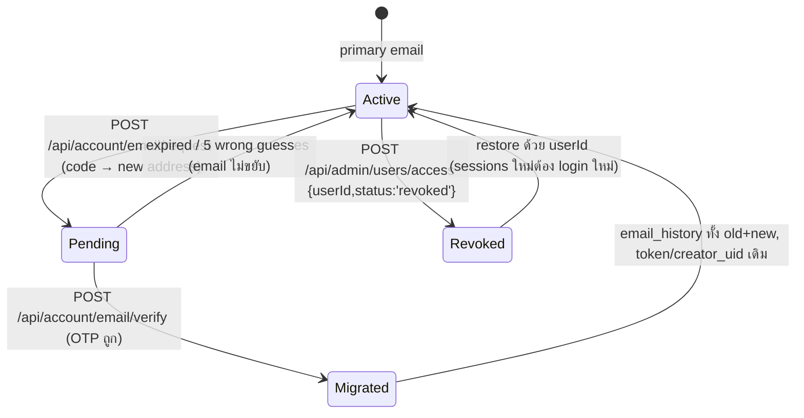

# ADR-0019: ตัวตนของ creator คือบัญชี (user_id / creator_uid) — email เป็นแค่ attributes ที่ย้ายได้

สถานะ: accepted (2026-11-17) — implementation `server/migrations/0034_identity_and_token_lifetime.sql` + tests `server/tests/identity-and-token-lifetime.test.mjs`
relates: ADR-0018 (payment identity on the Worker), ADR-0013 (owner-locked zone), migration 0032 (studio tokens), migration 0028 (cosplay accounts)

## Context

Cosplay Creator Studio และ dashboard `analytic.instagoon.app` เปิดด้วย token ที่ admin ออกให้
ตอนนั้นสิ่งที่ผูกกับ "คน" มีปนกัน 2 แบบ:

* ผูกด้วย **บัญชี** (`users.id`) — studio_tokens.user_id, studio_creators.user_id, cosplay_accounts.user_id ⇒ ถูกต้อง
* ผูกด้วย **address** — `invites(email)`, `ADMIN_EMAIL`, `STAGING_EMAILS`, `ANALYTICS_ADMIN_EMAILS`, `studio_tokens.issued_email`

ช่องโหว่ที่ตรวจเจอในโค้ดรอบนี้ (ไม่ใช่สมมติฐาน)

1. `session()` เดิม join `invites ON i.email = u.email` และใช้ `COALESCE(i.status,'active')='active'`
   ⇒ revocation ที่เขียนไว้กับ email **หลุดทันที** ที่คนนั้นย้ายไปอีก address (Google rename หรือ alias ที่ถูกใช้ซ้ำ)
2. Google callback เดิมเขียน `UPDATE users SET email=?` เมื่อ address ที่ Google ส่งมาต่างจากในฐานข้อมูล
   ⇒ account ย้าย address ตามบุคคลที่สามได้โดยไม่มี การยืนยันจากเจ้าของ, และ address ที่เคยใช้ยืนยันการจ่ายเงิน/KYC หายไปจาก row โดยไม่มีประวัติ
3. `issued_email` เป็นได้ทั้ง "email ที่ออกให้" และ "email ที่ใช้จริง" พร้อมกัน โดยไม่มีที่เก็บทั้งสองค่า
   ⇒ การส่งมอบ token ครั้งแรกให้ creator ที่ยังไม่ได้เลือก address ทำงานได้เพราะ code ไม่ได้เทียบ email เลย — แต่ไม่มีอะไรบันทึกไว้ว่าใครใช้ address ไหนจริง
4. token เก็บแค่ SHA-256 (ดี) แต่ **ไม่มีวันหมดอายุ ไม่มี revoke ไม่มี last_used** ⇒ หล่นครั้งเดียว = เปิดใช้ได้ถาวร

## Decision

**Identity layer** — `users.id` (uuid) เป็นตัวตนเดียวที่ทุก subsystem อ้างถึง และ `creator_uid` (`ccu_…`)
ที่ mint พร้อม token เป็น public identity ของ creator (ไม่เปลี่ยนตลอดชีวิต) ส่วน `creator_id` (`cos_<handle>`)
ล็อกค่าไว้ตอน launch แรกแล้ว (index.mjs:2107) จึงไม่ต้องแตะ

**Email layer** — address เป็น attributes ที่ย้ายได้:

* `email_history(user_id,email,first_seen_at,last_seen_at)` เก็บทุก address ที่บัญชีนี้เคยแสดง
* `email_changes(user_id UNIQUE, new_email, code_hash, expires_at, attempts, verified_at)` — ขอเปลี่ยนได้ทีละรายการ
  code 10 hex, เก็บเฉพาะ hash, ใช้ครั้งเดียว, อายุ 15 นาที, limit 5 guess + 5 request/ชม. (นับผ่าน `activity`)
* Google callback **เลิกเขียน email เอง** — address ที่ Google รายงานจะถูกบันทึกลง `email_history` เป็น "เห็นแต่ยังไมได้ยืนยัน"
  เจ้าของต้องยืนยันผ่าน code บน address ใหม่เท่านั้น
* การผูก account เก่ากับ `google_id` ใหม่ด้วย email คงไว้เฉพาะ first binding (บัญชีที่เกิดก่อนยุค Google) ตามเดิม

**Access layer** — `users.access_status ('active'|'revoked')` ตัดสินสิทธิ์ด้วย id ไม่ใช่ address และ `invites`
มี `user_id` เพิ่ม: admin revoke ที่บัญชี ⇒ เขียน revoked ให้ทุก address ที่เคยเห็นของบัญชีนั้น + ลบ sessions;
restore ที่บัญชี ⇒ ปลดเฉพาะแถวที่ผูกกับ user_id นั้น (ไม่ไปแก้ revoke ของ address อื่น)

**Token layer** — `expires_at` จำกัดแค่ช่วง hand-over ก่อน redeem (หลังจาก creator เป็นเจ้าของ token แล้ว
การหมดอายุตามนาฬิกาจะขังเขาออกจากตัวละครตัวเอง), `revoked_at` ปิดทั้ง studio และ analytics bearer ทันที,
`last_used_at` ไว้เป็นหลักฐานว่า token ถูกใช้เมื่อไร, TTL ตั้งผ่าน `STUDIO_TOKEN_TTL_DAYS` (default 30 วัน),
และ `issued_email` กลายเป็น optional เพราะการส่งมอบครั้งแรกมักส่งให้คนที่ยังไม่เลือก address

## Consequences

* ผู้ใช้ที่เปลี่ยน email ใน Google **ไม่ได้**ย้าย address ในระบบเราอัตโนมัติอีกแล้ว — ต้องกดยืนยัน code.
  ผลข้างเคียง: address ในฐานข้อมูลอาจเก่ากว่าของจริงได้ ชั่วคราว (มองเห็นได้ใน `email_history`)
* ยังไม่มี UI ฝั่ง creator สำหรับ flow นี้ — endpoint พร้อมใช้, ต้องเพิ่มฟอร์มใน `CosplayCreatorAccess`
  และ verify บน staging จริงก่อน ship
* การส่ง code ต้องมี mail transport: ตั้ง `EMAIL_CODE_WEBHOOK` (secret,รูปแบบเดียวกับ `DISCORD_REPORT_WEBHOOK`)
  ถ้าไม่ตั้ง endpoint จะตอบ `503 email_transport_missing` แทนที่จะทำเป็นครึ่งๆกลางๆ. `DEV_EMAIL_CODES=true`
  ส่ง code กลับมาใน response ด้วย — **เฉพาะเครื่อง dev** ห้ามตั้งบน staging/prod
* Prod ต้อง apply 0034 ก่อน deploy (additive เท่านั้น ไม่มี destructive,ข้อมูลเก่า default = 'active')

## Verification

`pnpm test` = 173/173 (167 baseline + 6 ใหม่): same-email/taken-email refusal, single-use + expiry + attempt caps,
hook delivery stores hash only, Google sign-in no longer rewrites email, revoke survives an email change and closes
sessions + studio + analytics, token expiry before claim and revocation after redeem.

