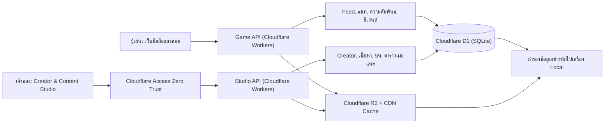

# แผน Social Story Platform (FrostStory) และ Creator & Content Studio

สถานะ: แผนภาพรวม ปรับขอบเขต closed beta วันที่ 29 ตุลาคม 2026

[ข้อตกลง MVP สำหรับ closed beta](froststory-beta-mvp.md) เป็นแหล่งอ้างอิงหลักสำหรับ beta หากแผนภาพรวมและบันทึกการออกแบบเดิมขัดกัน ให้ใช้ข้อตกลง MVP

เอกสารนี้รวบรวมข้อตกลงจาก [บันทึกการออกแบบ](social-story-platform-discovery.md) คำศัพท์มาตรฐานอยู่ใน [Glossary](../GLOSSARY.md) และการตัดสินใจเชิงสถาปัตยกรรมบันทึกไว้ใน [ADR-0004](adr/0004-script-revision-pinning-and-per-post-comment-cap.md) และ [ADR-0005](adr/0005-cloudflare-zero-cost-stack-and-offsite-backup.md)

## 1. เป้าหมายและขอบเขต

สร้างเกมโซเชียลออนไลน์แบบ responsive ภายใต้ชื่อโครงการ **FrostStory** (สามารถปรับเปลี่ยนชื่อแบรนด์และโลโก้ผ่านหลังบ้านได้ภายหลัง) ตลาดเริ่มต้นคือประเทศไทย (ภาษาไทยเป็นหลัก รองรับโครงสร้างหลายภาษาในอนาคต) ผู้เล่นติดตามโลกสมมติของ AI Creator ซึ่งเจ้าของระบบสร้างและควบคุมทั้งหมด เกมนี้แยกจาก Overtime Secrets โดยสมบูรณ์ โดยพัฒนาเป็นแอปพลิเคชันแยกอิสระภายใน Monorepo เดียวกันเพื่อนำ UI ต้นแบบจาก `src/modules/insta-chat/` มาต่อยอดโดยใช้ฐานข้อมูลและบริการคลาวด์แยกขาด 100%

การออกแบบข้อมูลครอบคลุมประสบการณ์โซเชียลทั้งระบบ ได้แก่ Feed, โปรไฟล์, โพสต์, ภาพและวิดีโอ, Stories, Highlights, Reels, การติดตาม, ไลก์, คอมเมนต์, การแจ้งเตือนในแอป (In-App Notification Center) และ DM

ผู้เล่นเห็นคอมเมนต์ของกันและกัน แต่ไม่ตอบหรือไลก์คอมเมนต์ ติดตาม ส่งข้อความ หรือเปิดโปรไฟล์ของผู้เล่นคนอื่น ผู้เล่นไม่มีโพสต์ Stories หรือ Reels ของตัวเอง ช่วงทดสอบเลือกรูปโปรไฟล์จากชุดที่เตรียมไว้

Creator แบ่งเป็น **Default Creator** (ผู้เล่นใหม่ติดตามอัตโนมัติและเห็นโพสต์สาธารณะทันทีเมื่อเข้าเกม) และ **Unlockable Creator** (ครีเอเตอร์ลับที่ปรากฏให้ติดตามเมื่อผ่านเงื่อนไขเนื้อเรื่องหรือความสัมพันธ์) แชทเป็นบทและตัวเลือกที่เขียนไว้ ไม่มีคำตอบ AI สด ผู้เล่นย้อนแก้ตัวเลือกที่ยืนยันแล้วไม่ได้

## 2. ภาพรวมระบบ

เส้นแบ่งสำคัญคือเนื้อหาฉบับร่างกับเนื้อหาที่เผยแพร่ และข้อมูลส่วนรวมกับความคืบหน้าของผู้เล่นแต่ละคน Game API ส่งเฉพาะข้อมูลที่ผู้เล่นมีสิทธิ์เห็นในขณะนั้น การซ่อนปุ่มในเบราว์เซอร์ไม่ใช่การตรวจสิทธิ์

## 3. ประสบการณ์ผู้เล่น

- หน้าแนะนำเกมเปิดดูได้โดยไม่เข้าสู่ระบบ ผู้เล่นเข้าสู่ระบบก่อนเริ่มเล่นด้วย Google OAuth สำหรับ beta (จัดการเซสชันบน D1) พร้อมยืนยันอายุ 18+ และยอมรับเงื่อนไข (`AgeConsentModal`) ในครั้งแรกโดยไม่เก็บสำเนาบัตรประชาชน
- Feed แสดงโพสต์ที่ผ่านเงื่อนไขการมองเห็น เรียงตามเวลา และรองรับโพสต์ปักหมุดที่เจ้าของกำหนด Creator มีโปรไฟล์ โพสต์ สื่อ และ Highlights
- Stories แยกเป็น 2 ชนิดตาม [Glossary](../GLOSSARY.md):
  1. **Broadcast Story**: ผูกกับปฏิทินเผยแพร่กลางของ Creator นับเวลาหมดอายุ 24 ชั่วโมงตามเวลาเซิร์ฟเวอร์พร้อมกันทุกคน (ย้ายเข้า Highlight ได้)
  2. **Unlockable Story**: สตอรี่เฉพาะบุคคลที่ปลดล็อกตามเงื่อนไข โดยจะเริ่มนับเวลาหมดอายุ 24 ชั่วโมงเมื่อผู้เล่นกดเปิดดูครั้งแรก (`firstViewedAt`) เท่านั้น เพื่อป้องกันการพลาดเนื้อเรื่องขณะออฟไลน์
- ผู้เล่นไลก์และคอมเมนต์โพสต์ Creator ได้ ผู้เล่นเห็นคอมเมนต์ร่วมกันเฉพาะโพสต์ที่ตนมีสิทธิ์เห็น คอมเมนต์ปรากฏทันที มีปุ่มรายงานและจำกัดความถี่
- เจ้าของกำหนดยอดไลก์จำลองและคอมเมนต์จาก Creator ได้ ระบบเก็บยอดจำลองแยกจากไลก์จริงและแสดงผลรวม ส่วน Dashboard แสดงทั้งสองยอด
- DM แสดงบทและตัวเลือกที่เผยแพร่แล้วโดยผูกกับรุ่นของบท (**Script Revision Pinning**) ตัวเลือกเปลี่ยนสถานะเรื่องและความสัมพันธ์ตามกฎที่เจ้าของกำหนด ผู้เล่นอ่านประวัติได้แต่แก้ตัวเลือกที่ยืนยันแล้วไม่ได้
- อีเวนต์ตรวจทั้งความสัมพันธ์กับ Creator และความคืบหน้าเรื่องตามที่กำหนด เรื่องหลักเป็นรายผู้เล่น กิจกรรมร่วมอาจอิงเวลาจริง

## 4. Energy และการซื้อ

ผู้เล่นเริ่มด้วย Energy ฟรี 3 หน่วย คอมเมนต์แรกที่ส่งสำเร็จในแต่ละโพสต์ใช้ 1 หน่วยและเพิ่มความสัมพันธ์กับ Creator ของโพสต์ 1 หน่วย **จำกัดการใช้ Energy เพื่อคอมเมนต์และรับแต้มความสัมพันธ์ (+1) ได้สูงสุด 1 ครั้งต่อ 1 โพสต์ต่อผู้เล่น** (ป้องกันการปั๊มแต้มซ้ำในโพสต์เดิมตาม [ADR-0004](adr/0004-script-revision-pinning-and-per-post-comment-cap.md)) แม้คอมเมนต์จะถูกซ่อนหรือลบภายหลัง ระบบไม่คืน Energy และไม่หักความสัมพันธ์ย้อนหลังจากการซ่อนหรือลบ

เมื่อใช้ Energy ฟรีครั้งแรก เริ่มนับ 4 ชั่วโมง เมื่อครบเวลาเติมฟรีกลับเป็น 3 หน่วยโดยไม่สะสมเกิน 3 โทเคนที่ซื้อแยกจากโทเคนฟรีและไม่ถูกลบเมื่อเติมฟรี ระบบใช้โทเคนฟรีก่อน กรณีใช้โทเคนฟรีอีกระหว่างรอบไม่เลื่อนกำหนดเติมของรอบนั้น กำหนดรอบถัดไปเมื่อมีการใช้โทเคนฟรีหลังเติมแล้ว

เซิร์ฟเวอร์ใช้เวลาของเซิร์ฟเวอร์เอง ตรวจสิทธิ์รับแต้มครั้งแรกต่อโพสต์ ยอด Energy และเงื่อนไขโพสต์ จากนั้นบันทึกคอมเมนต์ หัก Energy ผ่าน **Token Ledger** (Append-Only) และเพิ่มความสัมพันธ์ในธุรกรรมเดียวบน D1 คำขอที่ส่งซ้ำต้องไม่หักหรือให้คะแนนซ้ำ และต้องไม่หัก Energy หากส่งคอมเมนต์ไม่สำเร็จ คอมเมนต์เพิ่มเติมในโพสต์เดิมฟรีและไม่ได้แต้ม โดยยังจำกัดความถี่

ช่วงทดสอบไม่มีหน้าซื้อ ผู้ดูแลเพิ่มยอดจำลองเพื่อทดสอบได้เท่านั้น รายการจำลองแยกชัดเจนจากรายการเงินจริงและไม่เปิดช่องให้บัญชีผู้เล่นเพิ่มยอดเองได้ เมื่อเปิดขายจริงหากเกิดการดึงเงินคืน (Chargeback / Dispute) ระบบจะหักเฉพาะ `Purchased Energy Token` ในสมุดบัญชี (ยอมให้ยอดซื้อติดลบหรือระงับบัญชีชั่วคราวได้) โดยไม่คำนวณย้อนหลังเพื่อลดค่าความสัมพันธ์หรือล็อกเนื้อเรื่องที่ปลดล็อกไปแล้ว เจ้าของสามารถปรับยอดผ่านเครื่องมือ Admin Ledger Adjustment พร้อมระบุเหตุผลกำกับเสมอ

## 5. Creator & Content Studio

หลังบ้านออนไลน์รองรับผู้ดูแลคนเดียวตั้งแต่สร้างจนเผยแพร่ ป้องกันทางเข้า `/studio` ด้วย Cloudflare Access Zero Trust และออกแบบสิทธิ์เผื่อสมาชิกทีมในอนาคต

| พื้นที่ทำงาน | สิ่งที่เจ้าของทำได้ |
| --- | --- |
| Dashboard | ดูงานค้าง คอนเทนต์ตามเวลา รายงานคอมเมนต์ การใช้โควตา และสถานะสำรองข้อมูล |
| Creator | เพิ่ม Creator เอง (ตั้งเป็น Default หรือ Unlockable) จัดการชื่อ โปรไฟล์ บุคลิก ความสัมพันธ์ระหว่าง Creator และทรัพยากรของตัวละคร |
| Content library | อัปโหลด จัดหมวด ค้นหา และนำภาพ (`.webp`) หรือวิดีโอสั้น (`.mp4`/`.webm` ไม่เกิน 10–15 วินาที ขนาด 2–5 MB) กลับมาใช้ |
| Social editor | สร้างโพสต์ Broadcast Stories, Unlockable Stories, Reels กำหนด Creator ที่เกี่ยวข้อง ยอดไลก์จำลอง คอมเมนต์ของ Creator และเงื่อนไขการมองเห็น |
| Story and chat editor | เขียนข้อความ ตัวเลือก เงื่อนไข ผลต่อความสัมพันธ์ และอีเวนต์ พร้อมจำลองการเล่นและดูสถานะผู้เล่นจำลอง |
| Calendar | ตั้งเวลา ดูตารางเผยแพร่ และจัดชุดคอนเทนต์ล่วงหน้า |
| Review and publish | บันทึกฉบับร่าง ดูตัวอย่าง ตรวจลิงก์และเงื่อนไข เผยแพร่เป็น `Script Revision` และดูประวัติรุ่น |
| Moderation | ดูรายงาน ค้นหา ซ่อนหรือลบคอมเมนต์ พร้อมบันทึกผู้ดำเนินการและเหตุผล |
| Economy and operations | ดูยอดและประวัติ `Token Ledger` ปรับยอดด้วย Admin Adjustment รายการจำลอง ข้อพิพาท การใช้โควตา และสถานะสำรองข้อมูล |

นโยบายการแก้บทที่เผยแพร่แล้ว (**Immutable Script Revision Pinning**): เมื่อผู้เล่นเริ่มเธรดแชท ระบบจะล็อกเธรดนั้นไว้กับ `revisionId` ที่เริ่มเล่นจนจบเธรด การแก้ไขทุกชนิดรวมถึงคำผิดต้องสร้าง Revision ใหม่สำหรับผู้เล่นที่เริ่มเธรดถัดไป ผู้ดูแลระงับเนื้อหาเร่งด่วนได้โดยแจ้งผู้เล่น

## 6. ข้อมูลและกฎหลัก

| กลุ่มข้อมูล | ตัวอย่าง |
| --- | --- |
| ผู้เล่น | บัญชี โปรไฟล์ เวลาที่ยืนยันอายุ 18+ (`ageVerifiedAt`) รุ่นข้อตกลง (`consentVersion`) และสถานะบัญชี |
| โลกและ Creator | Creator (`Default` / `Unlockable`) ความสัมพันธ์ระหว่าง Creator โปรไฟล์และสื่อ |
| คอนเทนต์ | โพสต์ `Broadcast Story` `Unlockable Story` Reel ไฟล์สื่อ ตารางเวลา รุ่นเผยแพร่ และเงื่อนไขมองเห็น |
| ปฏิสัมพันธ์ | ไลก์จริง ยอดไลก์จำลอง คอมเมนต์ (จำกัดสิทธิ์รับแต้มโพสต์ละ 1 ครั้ง/ผู้เล่น) รายงานและประวัติการดูแล |
| เรื่องและแชท | บท ตัวเลือก เงื่อนไข ผลลัพธ์ อีเวนต์และ `Script Revision` |
| สถานะรายผู้เล่น | ความสัมพันธ์ต่อ Creator ประวัติตัวเลือก `revisionId` ที่กำลังเล่น การปลดล็อกและเวลา `firstViewedAt` ของ `Unlockable Story` |
| Economy | ยอดฟรีและยอดซื้อ รอบเติม รายการ `Token Ledger` แบบ Append-Only คำสั่งซื้อและข้อพิพาท |
| หลังบ้าน | สิทธิ์ การเผยแพร่ ประวัติการเปลี่ยนแปลงและบันทึกการดำเนินการ (`auditReason`) |

ข้อมูลที่เป็นความลับหรือยังไม่ปลดล็อกไม่ส่งให้เบราว์เซอร์ล่วงหน้า

## 7. ปริมาณการผลิตคอนเทนต์

ฐานประมาณการช่วงทดสอบคือ 5 Creator และผู้เล่นไม่เกิน 100 คน ไม่ใช่เพดานถาวร เจ้าของเพิ่ม Creator ผ่านหลังบ้านได้โดยไม่แก้ระบบ ชุดตั้งต้นต่อ Creator คือ 10 โพสต์ 5 Stories แชทเริ่มต้น 1 เส้นเรื่อง และอีเวนต์ความสัมพันธ์อย่างน้อย 1 เหตุการณ์ รวมอย่างน้อย 50 โพสต์ 25 Stories 5 เส้นเรื่อง และ 5 อีเวนต์

ลำดับงานสำหรับคนเดียวคือ กำหนดบุคลิกและความสัมพันธ์ระหว่าง Creator จัดชุดภาพและคลิปสั้น (ขนาดไม่เกิน 2–5 MB ยาวไม่เกิน 10–15 วินาที) เขียนโพสต์และบท วางเงื่อนไข ทดสอบเส้นทาง แล้วตั้งเวลาเผยแพร่ เครื่องมือค้นหาและใช้สื่อซ้ำได้ ตรวจข้อมูลขาดและทางตันก่อนปล่อย

## 8. คลาวด์ฟรีและข้อจำกัด (Cloudflare Zero-Cost Stack)

ตัวเลขโควตาด้านล่างเป็นข้อมูลจากแผนเดิม ต้องตรวจราคาและข้อจำกัดปัจจุบันก่อนใช้งานจริง เลือกใช้สถาปัตยกรรม Cloudflare งบ 0 บาทตาม [ADR-0005](adr/0005-cloudflare-zero-cost-stack-and-offsite-backup.md):
- **Cloudflare Workers Free**: รัน Game API, Studio API และเสิร์ฟเว็บแอป (100,000 คำขอต่อวัน)
- **Cloudflare D1 Free**: ฐานข้อมูล SQLite หลัก (อ่าน 5 ล้านแถว/วัน เขียน 100,000 แถว/วัน พื้นที่ 5 GB)
- **Cloudflare R2 Free + CDN Cache**: เก็บภาพ `.webp` และคลิปสั้น `.mp4`/`.webm` (ฟรี 10 GB) พร้อมตั้ง `Cache-Control` ผ่าน CDN เพื่อลดจำนวนการอ่านจาก R2
- **Cloudflare Access (Zero Trust Free)**: ล็อกสิทธิ์เข้าถึงหน้า `/studio` สำหรับเจ้าของระบบ

ตั้งระบบติดตามโควตาใน Dashboard จำกัดขนาดอัปโหลดต่อไฟล์ และแสดงข้อผิดพลาดอย่างปลอดภัยโดยไม่ทำธุรกรรมค้างหากโควตาเต็ม

## 9. ความปลอดภัยและการดูแลข้อมูล

- แยกพื้นที่ผู้เล่นและหลังบ้าน ตรวจตัวตนและสิทธิ์บนเซิร์ฟเวอร์ทุกคำขอ ไม่เชื่อค่า role หรือยอด Energy ที่ส่งจากเบราว์เซอร์
- บัญชีเจ้าของป้องกันด้วย Cloudflare Access Zero Trust และเก็บบันทึกการเผยแพร่ แก้ยอด และการดูแลคอมเมนต์
- เก็บความลับและข้อมูลเข้าสู่ระบบนอกโค้ดที่ส่งให้เบราว์เซอร์ จำกัดสิทธิ์เข้าถึงฐานข้อมูลและคลังสื่อ ใช้ HTTPS ป้องกันการส่งคำขอปลอม และจำกัดอัตราคำขอ
- ตรวจชนิด ขนาด และสิทธิ์ไฟล์อัปโหลด แยกสื่อฉบับร่างหรือสื่อที่ยังไม่ปลดล็อกจากสื่อสาธารณะ โดยตรวจสิทธิ์ก่อนส่งไฟล์
- **การสำรองข้อมูลแยกจากบริการหลัก (Off-Site Backup งบ 0 บาท)**: ส่งออกฐานข้อมูล D1 (`wrangler d1 export`) และซิงก์คลังสื่อ R2 ลงเครื่อง Local Master Archive ของเจ้าของ (Mac Mini M4 Pro) โดยเข้ารหัสและจำกัดสิทธิ์ ไม่เก็บฐานข้อมูลผู้เล่นหรือประวัติแชทใน Private Git สำรองอย่างน้อยวันละครั้งและทดสอบกู้คืนจริงก่อนเปิดทดสอบ
- **การลบบัญชีและ PDPA**: เมื่อผู้เล่นขอลบบัญชี ระบบจะลบข้อมูลส่วนบุคคล ประวัติแชท และ **ลบคอมเมนต์ของผู้เล่นนั้นออกจากหน้าโพสต์ทั้งหมดทันที** โดยคงเหลือเฉพาะรายการธุรกรรมใน `Token Ledger` แบบไม่ระบุตัวตน
- **ขอบเขตเนื้อหา 18+**: กำหนดเป็น **ระดับ A (Ecchi / Gravure / Suggestive 18+)** คือภาพแนวเซ็กซี่ ชุดว่ายน้ำ คอสเพลย์ และบทสนทนาโรแมนติก/ยั่วยวน โดยไม่มีภาพเปลือยโจ่งแจ้ง (Explicit NSFW) ต้องตรวจนโยบายของ Cloudflare และผู้ให้บริการที่เกี่ยวข้องก่อนเปิดใช้งานจริง

## 10. ลำดับการพัฒนาและตรวจรับ

1. **ตั้งค่าโครงสร้างแอปและฐานข้อมูล D1/R2** แยกโมดูล FrostStory ใน Monorepo สร้าง Schema D1 (ผู้เล่น, Creator, คอนเทนต์, `Script Revision`, `Token Ledger`) และสคริปต์สำรองข้อมูลลงเครื่อง Local
2. **สร้างระบบยืนยันตัวตนและความปลอดภัย** ระบบเข้าสู่ระบบ Google สำหรับ beta, หน้าต่างยืนยันอายุ 18+ (`AgeConsentModal`), ระบบลบบัญชี และการป้องกัน `/studio`
3. **สร้าง Creator & Content Studio และระบบเผยแพร่** จัดการ Creator (`Default`/`Unlockable`), คลังสื่อ, โพสต์, `Broadcast Story`, `Unlockable Story`, บทแชทพร้อมระบบ `Script Revision` และตารางเวลา
4. **สร้างประสบการณ์โซเชียลของผู้เล่น** Feed, โปรไฟล์, Story Viewer (แยกตรรกะเวลาของ `Broadcast Story` และ `Unlockable Story`), Highlight, Reel, ไลก์, คอมเมนต์, การแจ้งเตือนในแอป และ Moderation
5. **สร้างแชท ความสัมพันธ์ และ Energy** บทสนทนาที่ผูกกับ `revisionId`, รอบเติมฟรี 4 ชั่วโมง, ธุรกรรมคอมเมนต์ (จำกัด 1 ครั้ง/โพสต์/ผู้เล่น เพื่อรับ +1 ความสัมพันธ์) และเครื่องมือ Admin Ledger Adjustment
6. **เตรียมคอนเทนต์และทดสอบปิด** ผลิตชุดเริ่มต้นสำหรับ 5 Creator ทดสอบบนมือถือและคอม ทดสอบโควตาและกู้คืนข้อมูล ก่อนเปิดรับผู้เล่นกลุ่มทดสอบสูงสุด 100 คน
7. **เตรียมขายจริงในอนาคต** เชื่อมต่อระบบชำระเงินจริงภายใต้ขอบเขตเนื้อหาระดับ A พร้อมระบบจัดการข้อพิพาทตามนโยบาย `Token Ledger`

## 11. สรุปประเด็นที่ตัดสินใจครบแล้ว

- **ชื่อแบรนด์และตลาด**: ใช้ชื่อโครงการ **FrostStory** ตลาดเริ่มต้นประเทศไทย (ภาษาไทยเป็นหลัก) แยกจาก Overtime Secrets 100%
- **ระดับเนื้อหา 18+**: **ระดับ A (Ecchi / Suggestive 18+)** ไม่มีภาพเปลือยโจ่งแจ้ง ใช้การยืนยันอายุผ่าน `AgeConsentModal` โดยไม่เก็บสำเนาบัตรประชาชน
- **บริการคลาวด์และสำรองข้อมูล 0 บาท**: Cloudflare Workers + D1 + R2 + Cloudflare Access Zero Trust สำรองข้อมูลผู้เล่นแบบเข้ารหัสไปที่เครื่อง Local ของเจ้าของ (Mac Mini M4 Pro) โดยไม่ส่งฐานข้อมูลผู้เล่นหรือประวัติแชทขึ้น Private Git
- **กติกา Story 24 ชม.**: แยกเป็น `Broadcast Story` (นับเวลาตามเซิร์ฟเวอร์) และ `Unlockable Story` (เริ่มนับ 24 ชม. เมื่อผู้เล่นเปิดดูครั้งแรก `firstViewedAt`)
- **กติกาคอมเมนต์และ Energy**: ใช้ Energy 1 หน่วยและได้ความสัมพันธ์ +1 จำกัดโพสต์ละ 1 ครั้งต่อผู้เล่น
- **การแก้บทแชทที่เผยแพร่แล้ว**: ใช้ `Immutable Script Revision Pinning` ล็อกรุ่นบทให้ผู้เล่นที่กำลังคุยค้างอยู่จนจบเธรด
- **การลบบัญชีและข้อพิพาท**: เมื่อลบบัญชีจะลบข้อมูลส่วนตัวและลบคอมเมนต์ออกจากโพสต์ทั้งหมด ส่วนกรณีดึงเงินคืนจะปรับยอดใน `Token Ledger` โดยไม่ลดค่าความสัมพันธ์ย้อนหลัง
